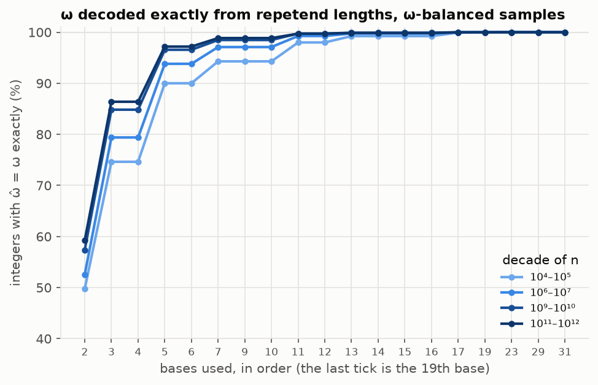

# Sieve Echo v11 — claim verdicts (decode-s0)

- **Run:** `decode-s0`, config `empirical-scripts/11.0/config/orders.json` (sha256 `a829e308ad`), seed 0.
- **Code:** root `61b63ebb15` (dirty), libs/evolvo `d2111859f0`, v11 sources sha256 `79637a1f58`.
- **Definitions:** `None`; primary base set `None`; entropies .
- **Data:** None integers, None coprime (n, b) pairs; split None (split sha256 `unknown`).
- **Inference:** None bootstrap resamples (95% percentile CIs over test rows), None permutations; effect threshold None (ΔR², η² excess, r²).

Paper statistics are re-computed the way the v8.2 code computed them (in-sample, `H_v8`, n ∈ [2, 9999]); corrected tests fit on the train split and report on the test split.

## Figures

*Share of integers whose ω is recovered exactly by the training-free decoder (Proposition 1.7) using the first k of the 19 bases, per decade of n (ω-balanced samples, step 13). Base 4 adds nothing to base 2 because 4 = 2².*

## Verdicts

No `claims` stage in this run; see the sections below.

## Step 13 — Exact decoding of ω from the repetends

For each base b of [2, 3, 4, 5, 6, 7, 9, 10, 11, 12, 13, 14, 15, 16, 17, 19, 23, 29, 31] coprime to n, with L = ord_n(b) and each prime q | L, the tests gcd(b^((L/q^v) q^i) − 1, n) (i < v = v_q(L)) split n; ω̂ = size of the resulting coprime base (Proposition 1.7: ω̂ ≤ ω, exact when the prime divisors have distinct order vectors). No training; b^d mod n is the remainder after d digits of 1/n in base b.

**Every n in [2, 100000000]** (99999999 integers): ω̂ = ω for 100.000% (9 failures); q = 2 only (Shor's half-period split): 99.896%; with pre-periods of non-coprime bases: 100%. First 1 / 2 / 5 / 10 bases: 49.938% / 83.245% / 96.618% / 99.682%.

Failures (n, ω, ω̂, ω̂ with pre-periods): (3741870, 7, 6, 7), (18709350, 7, 6, 7), (26193090, 8, 7, 8), (41160570, 7, 6, 7), (48644310, 8, 7, 8), (63611790, 7, 6, 7), (71095530, 8, 7, 8), (86063010, 7, 6, 7), (93546750, 7, 6, 7)

**ω-balanced samples** (exact ω):

| decade | integers | all bases | failures | first 5 bases | 11 prime bases | q = 2 only | bases needed (mean / p99 / max) | Midy = Shor failure |
| --- | --- | --- | --- | --- | --- | --- | --- | --- |
| 10000–99999 | 13808 | 100% | 0 | 90.006% | 100% | 99.928% | 2.45 / 11 / 17 | 84677/84677 |
| 100000–999999 | 15000 | 100% | 0 | 91.320% | 100% | 99.880% | 2.34 / 11 / 18 | 93421/93421 |
| 1000000–9999999 | 15000 | 100% | 0 | 93.813% | 100% | 99.893% | 2.12 / 9 / 17 | 99485/99485 |
| 10000000–99999999 | 15000 | 100% | 0 | 95.180% | 100% | 99.887% | 1.98 / 9 / 17 | 107099/107099 |
| 100000000–999999999 | 15000 | 100% | 0 | 95.667% | 100% | 99.893% | 1.93 / 9 / 16 | 109077/109077 |
| 1000000000–9999999999 | 15000 | 100% | 0 | 96.560% | 100% | 99.867% | 1.85 / 9 / 17 | 112534/112534 |
| 10000000000–99999999999 | 15000 | 100% | 0 | 96.867% | 100% | 99.873% | 1.80 / 9 / 15 | 116573/116573 |
| 100000000000–999999999999 | 15000 | 100% | 0 | 97.187% | 100% | 99.807% | 1.78 / 9 / 17 | 117331/117331 |

**uniform samples** (exact ω):

| decade | integers | all bases | failures | first 5 bases | 11 prime bases | q = 2 only | bases needed (mean / p99 / max) | Midy = Shor failure |
| --- | --- | --- | --- | --- | --- | --- | --- | --- |
| 10000–99999 | 17949 | 100% | 0 | 96.596% | 100% | 99.967% | 1.96 / 9 / 17 | 115557/115557 |
| 100000–999999 | 19774 | 100% | 0 | 96.718% | 100% | 99.954% | 1.96 / 9 / 17 | 130191/130191 |
| 1000000–9999999 | 19978 | 100% | 0 | 96.566% | 100% | 99.940% | 1.96 / 9 / 17 | 131276/131276 |
| 10000000–99999999 | 19998 | 100% | 0 | 96.465% | 100% | 99.870% | 1.97 / 9 / 16 | 134510/134510 |
| 100000000–999999999 | 19999 | 100% | 0 | 96.750% | 100% | 99.810% | 1.95 / 9 / 16 | 136520/136520 |
| 1000000000–9999999999 | 20000 | 100% | 0 | 96.675% | 100% | 99.825% | 1.96 / 9 / 17 | 137813/137813 |
| 10000000000–99999999999 | 20000 | 100% | 0 | 96.670% | 100% | 99.810% | 1.97 / 9 / 17 | 135476/135476 |
| 100000000000–999999999999 | 20000 | 100% | 0 | 96.500% | 100% | 99.830% | 1.96 / 9 / 16 | 137369/137369 |

Accuracy by class min(ω, 5), ω-balanced (all bases / q = 2 only):

- 10000–99999: 1: 100% / 100%; 2: 100% / 100%; 3: 100% / 100%; 4: 100% / 99.933%; 5: 100% / 99.558%
- 100000–999999: 1: 100% / 100%; 2: 100% / 100%; 3: 100% / 99.933%; 4: 100% / 99.933%; 5: 100% / 99.533%
- 1000000–9999999: 1: 100% / 100%; 2: 100% / 100%; 3: 100% / 99.967%; 4: 100% / 99.933%; 5: 100% / 99.567%
- 10000000–99999999: 1: 100% / 100%; 2: 100% / 99.967%; 3: 100% / 99.967%; 4: 100% / 99.933%; 5: 100% / 99.567%
- 100000000–999999999: 1: 100% / 100%; 2: 100% / 99.967%; 3: 100% / 99.967%; 4: 100% / 99.933%; 5: 100% / 99.600%
- 1000000000–9999999999: 1: 100% / 100%; 2: 100% / 100%; 3: 100% / 100%; 4: 100% / 99.867%; 5: 100% / 99.467%
- 10000000000–99999999999: 1: 100% / 100%; 2: 100% / 100%; 3: 100% / 99.900%; 4: 100% / 100%; 5: 100% / 99.467%
- 100000000000–999999999999: 1: 100% / 100%; 2: 100% / 100%; 3: 100% / 99.933%; 4: 100% / 99.800%; 5: 100% / 99.300%

**From the digits** (13c): 4001 remainders read from ⌈log_b n⌉ repetend digits (mean 6.0, max 20), 0 mismatches; 600/600 integers (all 19 repetends ≤ 200000 digits) decoded to the exact ω from digits alone.

Full numbers: `decode.json` in this run directory.
