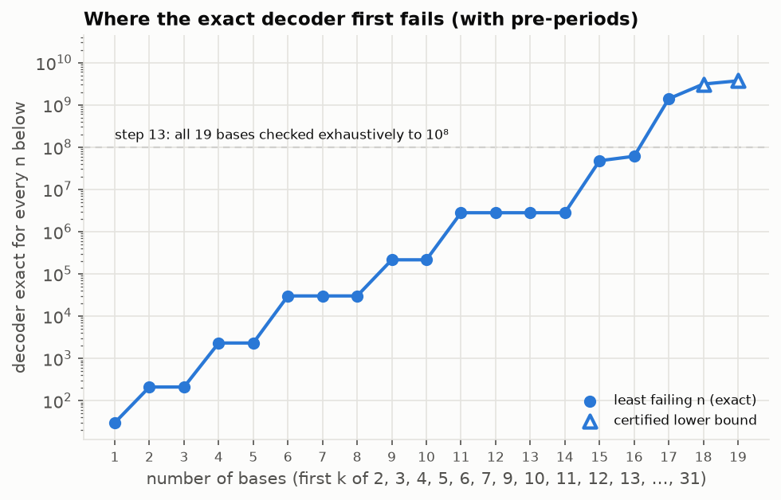

# Sieve Echo v11 — claim verdicts (failures-s0)

- **Run:** `failures-s0`, config `empirical-scripts/11.0/config/orders.json` (sha256 `115626b831`), seed 0.
- **Code:** root `dfd0a241ed` (dirty), libs/evolvo `d2111859f0`, v11 sources sha256 `e73f6f6476`.
- **Definitions:** `None`; primary base set `None`; entropies .
- **Data:** None integers, None coprime (n, b) pairs; split None (split sha256 `unknown`).
- **Inference:** None bootstrap resamples (95% percentile CIs over test rows), None permutations; effect threshold None (ΔR², η² excess, r²).

Paper statistics are re-computed the way the v8.2 code computed them (in-sample, `H_v8`, n ∈ [2, 9999]); corrected tests fit on the train split and report on the test split.

## Figures

*Least integer on which the step-13 decoder with pre-periods misses ω, for the first k of the 19 bases, from Proposition 1.8 (order vectors of all primes up to the prime limit); triangles are certified lower bounds (step 15).*

## Verdicts

No `claims` stage in this run; see the sections below.

## Step 15 — The decoder's failure set

Proposition 1.8: with pre-periods, the decoder isolates every prime that divides a base and fails only on n with two prime factors p ≠ p' outside them whose orders agree in every base coprime to n (iff for squarefree n). The least failing n is the minimum over the small-prime patterns S of ∏S times the least product of two such primes, found from the orders of the bases modulo every prime up to 100,000,000 (1336 of 2048 patterns searched after pruning).

**All 19 bases:** least failing n > 3,700,000,258 (no collision among primes ≤ 100,000,000 for pattern 1); the decoder is therefore exact for every n < 3,700,000,259. Pairs of primes ≤ 100,000,000 (outside the base primes) with equal orders in all 19 bases: 0.

| k | base added | least failing n with the first k bases | check |
| --- | --- | --- | --- |
| 1 | 2 | 30 (∏S = 2; p, p' = 3, 5) | 30 ✓ |
| 2 | 3 | 210 (∏S = 2·3; p, p' = 5, 7) | 210 ✓ |
| 3 | 4 | 210 (∏S = 2·3; p, p' = 5, 7) | 210 ✓ |
| 4 | 5 | 2,310 (∏S = 2·3·5; p, p' = 7, 11) | 2,310 ✓ |
| 5 | 6 | 2,310 (∏S = 2·3·5; p, p' = 7, 11) | 2,310 ✓ |
| 6 | 7 | 30,030 (∏S = 2·3·5·7; p, p' = 11, 13) | 30,030 ✓ |
| 7 | 9 | 30,030 (∏S = 2·3·5·7; p, p' = 11, 13) | 30,030 ✓ |
| 8 | 10 | 30,030 (∏S = 2·3·5·7; p, p' = 11, 13) | 30,030 ✓ |
| 9 | 11 | 214,935 (∏S = 3·5·7; p, p' = 23, 89) | 214,935 ✓ |
| 10 | 12 | 214,935 (∏S = 3·5·7; p, p' = 23, 89) | 214,935 ✓ |
| 11 | 13 | 2,794,155 (∏S = 3·5·7·13; p, p' = 23, 89) | 2,794,155 ✓ |
| 12 | 14 | 2,794,155 (∏S = 3·5·7·13; p, p' = 23, 89) | 2,794,155 ✓ |
| 13 | 15 | 2,794,155 (∏S = 3·5·7·13; p, p' = 23, 89) | 2,794,155 ✓ |
| 14 | 16 | 2,794,155 (∏S = 3·5·7·13; p, p' = 23, 89) | 2,794,155 ✓ |
| 15 | 17 | 47,500,635 (∏S = 3·5·7·13·17; p, p' = 23, 89) | decoder fails there ✓ |
| 16 | 19 | 60,555,495 (∏S = 3·5·7·11·13; p, p' = 37, 109) | decoder fails there ✓ |
| 17 | 23 | 1,392,776,385 (∏S = 3·5·7·11·13·23; p, p' = 37, 109) | decoder fails there ✓ |
| 18 | 29 | > 3,100,000,216 (no collision among primes ≤ 100,000,000 for pattern 1); least failure found 11,532,975,090 (∏S = 2·3·5·7·13; p, p' = 1187, 3559) | decoder fails there ✓ |

Full numbers: `failures.json` in this run directory.
