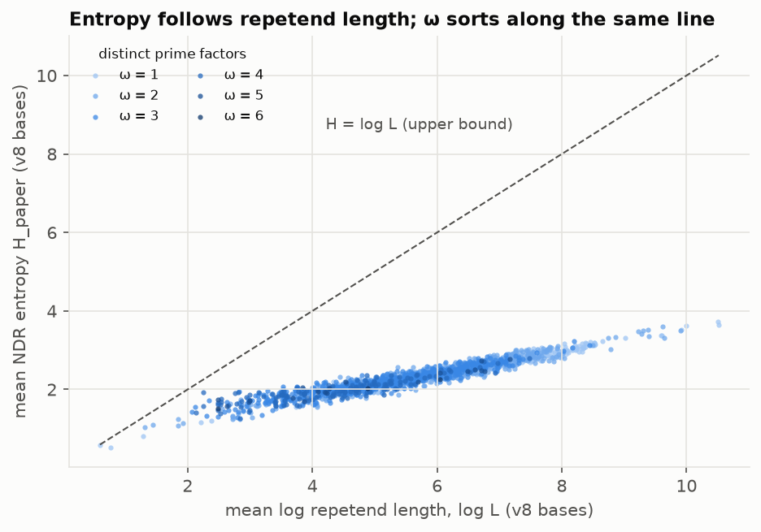
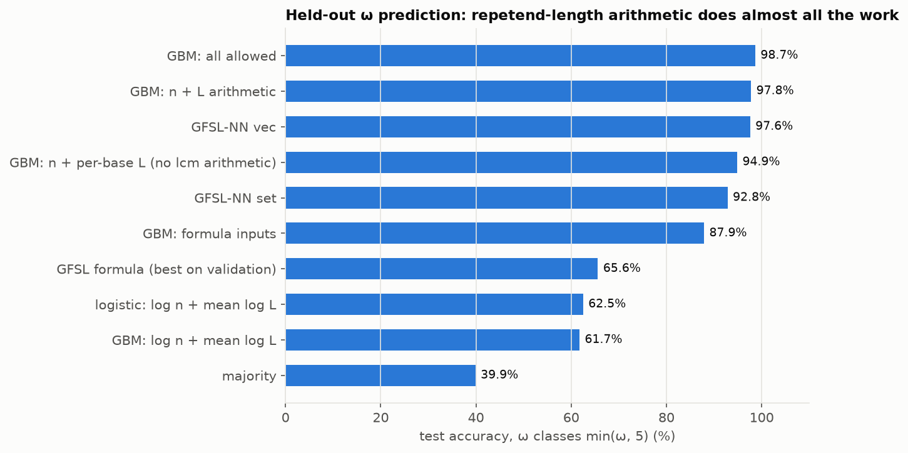
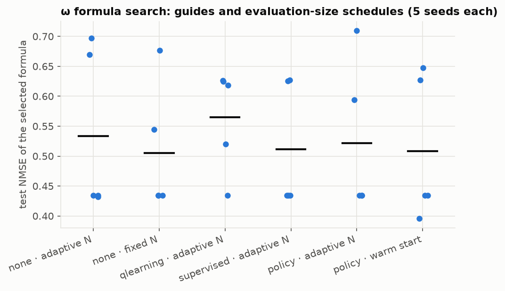
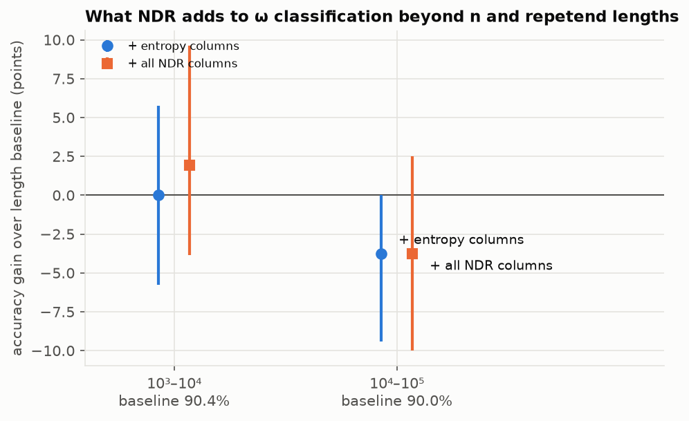
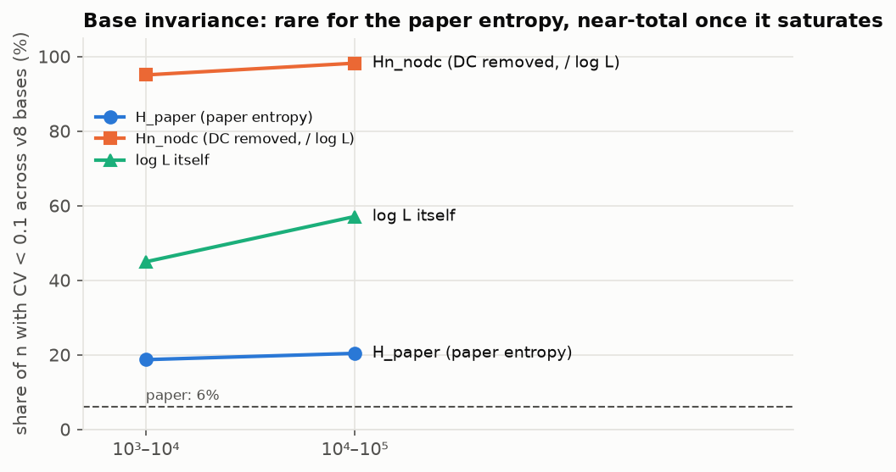
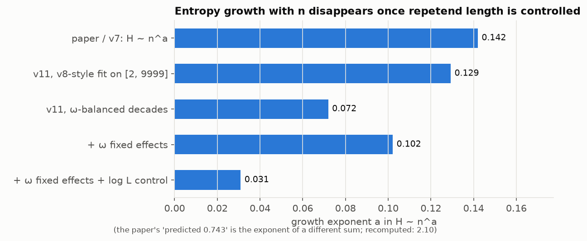

# Sieve Echo v11 — claim verdicts (quick-s0-step6)

- **Run:** `quick-s0-step6`, config `empirical-scripts/11.0/config/quick.json` (sha256 `226a8749cb`), seed 0.
- **Code:** root `eed2a83373` (dirty), libs/evolvo `d2111859f0`, v11 sources sha256 `9d27e80697`.
- **Definitions:** `ndr-v11.1`; primary base set `v8`; entropies `H_paper`, `H_nodc`, `Hn_paper`.
- **Data:** 10523 integers, 160064 coprime (n, b) pairs; split {'train': 7366, 'val': 1578, 'test': 1579} (split sha256 `2a3157648f`).
- **Inference:** 1000 bootstrap resamples (95% percentile CIs over test rows), 1000 permutations; effect threshold 0.01 (ΔR², η² excess, r²).

Paper statistics are re-computed the way the v8.2 code computed them (in-sample, `H_v8`, n ∈ [2, 9999]); corrected tests fit on the train split and report on the test split.

## Figures

*Test-split integers: mean H_paper against mean log L, coloured by ω. Points with more prime factors sit lower because their repetends are shorter, not off the H–log L curve (claims C1, C9).*

*Test accuracy of every ω model of step 4 (same split, same classes).*

*Test NMSE of the validation-selected ω formula per seed (dots) and mean (bar) for each guide / S1 schedule / S2 warm start (step 4).*

*Held-out gain (95% bootstrap CI) of gradient boosting when entropy or all NDR columns are added to the baseline of n, per-base repetend lengths and their lcm arithmetic, per ω-balanced n-range (step 5).*

*Share of integers whose statistic varies by less than 10% (CV) across the v8 bases, per ω-balanced n-range (claim C4, step 5).*

*Growth exponents of the NDR entropy with n, with and without ω and log L controls (step 5).*

## Verdicts

| Claim | Paper says | Paper statistic re-computed | Corrected test (held out, with controls) | Verdict |
| --- | --- | --- | --- | --- |
| **C1** Sieve Echo Law H = α·log ω + β (§2.2) | H_NDR = -0.468·log(ω) + 1.917, R² = 0.234 | reproduced | H_paper: test R² law-only 0.190, baseline (log L, log n) 0.925, full 0.925; ΔR² 0.0001 CI [-0.001, 0.001] (threshold 0.01); partial r(H, log ω \| log L, log n) -0.048. | **reproduced but explained by size/length** |
| **C2** Direction of the effect (§1.3, §7.1) | §1.3: primes give 'pure, low-entropy' patterns; §7.1: 'higher complexity correlates with higher entropy'; §2.2: α < 0 | reproduced | Measured on test (H_paper): primes minus composites mean H = 0.419 CI [0.358, 0.478]; Spearman(H, ω) -0.476 (negative); given log L and log n the sign is negative. Primes have the highest entropy, so §1.3 ('primes low-e… | **not supported** |
| **C3** Prime-power dichotomy (§2.3) | strongest predictor of NDR entropy is prime-power status, r = -0.843 | not reproduced | The paper's -0.843 is corr(ω, is_prime_power) (v11: -0.655 on [2, 9999]), not an entropy correlation. Actual r(H, prime power) on test = 0.309 (positive: prime powers have higher H); given log L, log n: -0.082 CI [-0.13… | **not reproduced** |
| **C4** Base invariance CV < 0.1 (§2.4, Q5.2) | base invariance in only 6% of cases | reproduced | v8.2's 6% is a 100-integer sample (v11 on all n in [2, 9999]: 0.091). Spearman(CV, log n) for v8/H_paper: -0.022 CI [-0.038, -0.001]. Highest overall rate: v8/Hn_nodc = 0.930. Normalized DC-free entropy saturates near i… | **reproduced; no asymptotic emergence** |
| **C5** Correlation with n^-s (zeta, §4.1) | H correlates with n^-s, decreasing in s (zeta connection) | reproduced | n^-s is a monotone function of n; after a cubic in log n the partial correlations are s=2: -0.030, s=3: -0.026, s=4: -0.023; H ~ log n alone has test R² 0.340. | **reproduced but explained by size/length** |
| **C6** H·log n vs prime number theorem (§4.2) | corr(H·log n, H) = 0.946 links NDR entropy to the PNT | reproduced | corr(H·log n, H) = 0.946; with H randomly permuted across n the same statistic is 0.831 CI [0.826, 0.836]: most of it comes from H appearing on both sides, the rest from H growing with n (corr(H, log n) = 0.593). PNT/Li… | **reproduced but explained by size/length** |
| **C7** Residue-class structure mod 6/12/30/210 (§4.3) | variance of residue-class mean H > 0.01 marks significant modular structure | reproduced | η² of residue class on test, raw → excess over the permutation null after controls. H_paper: mod 6: 0.209 → excess 0.005 (p 0.030), mod 12: 0.233 → excess 0.052 (p 0.002), mod 30: 0.252 → excess 0.017 (p 0.002), mod 210… | **supported (residue structure beyond per-base L and ω)** |
| **C8** Fitted constants vs theory and constant matching (§5) | α ≈ -0.468 ≈ tribonacci - ln 10, β ≈ 1.917 ≈ 1/φ² + ln 10; theory α = -1.599, β = 4.933 | reproduced | Theory constants inside a 95% CI: no. A value drawn at random near α matches some library combination within 0.01 with probability 0.87 (near β: 0.88), so the matches carry no evidence; α and β also change with log(ω) v… | **not supported** |
| **C9** Information about ω beyond L and n (core question) | NDR entropy patterns encode factorization complexity (Conj. 1.3) | n/a | Held-out ω classification: baseline (n, per-base L, lcm arithmetic) accuracy 0.978; +entropy features 0.980 (Δ +0.003 CI [-0.003, 0.009]); +all NDR features 0.986 (Δ +0.008 CI [0.003, 0.015], log-loss gain +0.0210 CI [0… | **supported (entropy features alone: not supported)** |

## C1 — Sieve Echo Law H = α·log ω + β (§2.2)

- **Paper:** H_NDR = -0.468·log(ω) + 1.917, R² = 0.234
- **Re-computed paper statistic (reproduced):** {"statistic": "OLS of v8-set mean H_v8 on log(omega+1), n in [2, 9999], in-sample", "paper": {"alpha": -0.4681, "beta": 1.9174, "r2": 0.2345}, "v11": {"log(omega+1) [v8.2 code]": {"alpha": -0.4681, "beta": 1.9174, "r2": 0.2345}, "log(omega) [paper text]": {"alpha": -0.3047, "beta": 1.6049, "r2": 0.2288}}}
- **Corrected test:** H_paper: test R² law-only 0.190, baseline (log L, log n) 0.925, full 0.925; ΔR² 0.0001 CI [-0.001, 0.001] (threshold 0.01); partial r(H, log ω | log L, log n) -0.048.
- **Verdict:** reproduced but explained by size/length

## C2 — Direction of the effect (§1.3, §7.1)

- **Paper:** §1.3: primes give 'pure, low-entropy' patterns; §7.1: 'higher complexity correlates with higher entropy'; §2.2: α < 0
- **Re-computed paper statistic (reproduced):** {"statistic": "sign of α in C1", "note": "α < 0 in the stored v8.2 fit"}
- **Corrected test:** Measured on test (H_paper): primes minus composites mean H = 0.419 CI [0.358, 0.478]; Spearman(H, ω) -0.476 (negative); given log L and log n the sign is negative. Primes have the highest entropy, so §1.3 ('primes low-entropy') and §7.1 item 2 are contradicted; only α < 0 holds.
- **Verdict:** not supported

## C3 — Prime-power dichotomy (§2.3)

- **Paper:** strongest predictor of NDR entropy is prime-power status, r = -0.843
- **Re-computed paper statistic (not reproduced):** {"statistic": "paper r = -0.843; source: v7.0 log line 210 `omega_vs_is_prime_power` (two factorization labels)", "paper": -0.843, "v11": {"corr(omega, is_prime_power), n in [2, 9999]": -0.6551, "corr(H_v8 mean, is_prime_power), n in [2, 9999]": 0.3311}, "note": "-0.843 is not an entropy statistic; its exact v7 sample is unknown."}
- **Corrected test:** The paper's -0.843 is corr(ω, is_prime_power) (v11: -0.655 on [2, 9999]), not an entropy correlation. Actual r(H, prime power) on test = 0.309 (positive: prime powers have higher H); given log L, log n: -0.082 CI [-0.131, -0.034].
- **Verdict:** not reproduced

## C4 — Base invariance CV < 0.1 (§2.4, Q5.2)

- **Paper:** base invariance in only 6% of cases
- **Re-computed paper statistic (reproduced):** {"statistic": "share of n with CV(H_v8 over v8 bases) < 0.1", "v11": {"paper": 0.06, "v11 first 100 of v8.2 data order": 0.06, "v11 all n in [2, 9999]": 0.0913}, "note": "v8.2 evaluated only data[:100]."}
- **Corrected test:** v8.2's 6% is a 100-integer sample (v11 on all n in [2, 9999]: 0.091). Spearman(CV, log n) for v8/H_paper: -0.022 CI [-0.038, -0.001]. Highest overall rate: v8/Hn_nodc = 0.930. Normalized DC-free entropy saturates near its maximum for long, noise-like repetends, so its CV shrinks with L; the CV of log L itself also falls with n.
- **Verdict:** reproduced; no asymptotic emergence

## C5 — Correlation with n^-s (zeta, §4.1)

- **Paper:** H correlates with n^-s, decreasing in s (zeta connection)
- **Re-computed paper statistic (reproduced):** {"statistic": "corr(n^-s, v8 mean H_v8) over v8.2 data[:100]", "v11": {"paper": {"2": -0.4407, "3": -0.3373, "4": -0.2892}, "v11 first 100 of v8.2 data order": {"2": -0.4407, "3": -0.3373, "4": -0.2892}, "v11 all n in [2, 9999]": {"2": -0.1143, "3": -0.0825, "4": -0.07}}}
- **Corrected test:** n^-s is a monotone function of n; after a cubic in log n the partial correlations are s=2: -0.030, s=3: -0.026, s=4: -0.023; H ~ log n alone has test R² 0.340.
- **Verdict:** reproduced but explained by size/length

## C6 — H·log n vs prime number theorem (§4.2)

- **Paper:** corr(H·log n, H) = 0.946 links NDR entropy to the PNT
- **Re-computed paper statistic (reproduced):** {"statistic": "corr(H·log n, H) over n in [3, 9999], v8 mean H_v8", "paper": {"pnt_entropy_product": 0.9465, "pnt_error": 0.5199, "li_error": 0.4959}, "v11": {"pnt_entropy_product": 0.9465, "pnt_error": 0.5199, "li_error": 0.4959}, "null_permuted_H": {"pnt_entropy_product_mean": 0.8307, "ci95": [0.8257, 0.8359]}}
- **Corrected test:** corr(H·log n, H) = 0.946; with H randomly permuted across n the same statistic is 0.831 CI [0.826, 0.836]: most of it comes from H appearing on both sides, the rest from H growing with n (corr(H, log n) = 0.593). PNT/Li errors are functions of n; partial r given log n: pnt -0.033, li -0.031.
- **Verdict:** reproduced but explained by size/length

## C7 — Residue-class structure mod 6/12/30/210 (§4.3)

- **Paper:** variance of residue-class mean H > 0.01 marks significant modular structure
- **Re-computed paper statistic (reproduced):** {"statistic": "variance of residue-class means of v8 mean H_v8, n in [2, 9999]", "paper": {"6": 0.0153, "12": 0.0169, "30": 0.018, "210": 0.0205}, "v11": {"6": 0.0153, "12": 0.0169, "30": 0.018, "210": 0.0205}}
- **Corrected test:** η² of residue class on test, raw → excess over the permutation null after controls. H_paper: mod 6: 0.209 → excess 0.005 (p 0.030), mod 12: 0.233 → excess 0.052 (p 0.002), mod 30: 0.252 → excess 0.017 (p 0.002), mod 210: 0.374 → excess 0.034 (p 0.006). H_nodc: mod 6: 0.126 → excess -0.001 (p 0.611), mod 12: 0.157 → excess 0.032 (p 0.002), mod 30: 0.184 → excess 0.008 (p 0.086), mod 210: 0.328 → excess 0.026 (p 0.026). Residues mod 6/12/30/210 fix divisibility by 2, 3, 5, 7 and the quadratic characters of the bases, which set the per-base orders.
- **Verdict:** supported (residue structure beyond per-base L and ω)

## C8 — Fitted constants vs theory and constant matching (§5)

- **Paper:** α ≈ -0.468 ≈ tribonacci - ln 10, β ≈ 1.917 ≈ 1/φ² + ln 10; theory α = -1.599, β = 4.933
- **Re-computed paper statistic (reproduced):** {"statistic": "v8.2 constant matching: 20 constants, singles and pairwise sums/differences, \|error\| < 0.01", "look_elsewhere": {"stored_match": "tribonacci - ln_10", "stored_match_value": -0.4633, "reproduced_alpha": -0.4681, "matches_within_0.01_of_reproduced_alpha": 1, "library_size": 20, "candidate_values": 605, "tolerance": 0.01, "chance_match_probability_near_alpha": 0.871, "chance_match_probability_near_beta": 0.8828}}
- **Corrected test:** Theory constants inside a 95% CI: no. A value drawn at random near α matches some library combination within 0.01 with probability 0.87 (near β: 0.88), so the matches carry no evidence; α and β also change with log(ω) vs log(ω+1) and with the entropy definition.
- **Verdict:** not supported

## C9 — Information about ω beyond L and n (core question)

- **Paper:** NDR entropy patterns encode factorization complexity (Conj. 1.3)
- **Re-computed paper statistic (n/a):** {"statistic": "no paper statistic controls for L"}
- **Corrected test:** Held-out ω classification: baseline (n, per-base L, lcm arithmetic) accuracy 0.978; +entropy features 0.980 (Δ +0.003 CI [-0.003, 0.009]); +all NDR features 0.986 (Δ +0.008 CI [0.003, 0.015], log-loss gain +0.0210 CI [0.006, 0.038]); majority 0.399, shuffled-label null 0.368.
- **Verdict:** supported (entropy features alone: not supported)

## Step 4 — Evolvo formula search

Inputs (12, z-scored on train): `log n`, `row.v8.logL.mean`, `row.v8.H_paper.mean`, `row.v8.H_nodc.mean`, `row.v8.H_paper.std`, `row.v8.H_paper.min`, `row.v8.Hn_nodc.mean`, `row.v8.mean.mean`, `log lcm(L_b)`, `log n - log lcm`, `lcm divides n-1`, `share of L_b dividing n-1`.
Population 100, 30 generations, seeds [0, 1, 2, 3, 4], parsimony 0.002 per instruction; fitness = 1/(1+NMSE) − parsimony·size on the first N train rows (S1: N from 5000 in steps of 500 to ≤ 100000, capped at 7366 train rows). q_target {'omega': 0.7, 'is_prime': 0.95}. Test metrics are for the genome selected on validation.

| target | guide | variant | runs | test NMSE | test accuracy | reached q_target | evaluations to target | final N | seconds |
| --- | --- | --- | --- | --- | --- | --- | --- | --- | --- |
| is_prime | none | adaptive | 5 | 0.0126 ± 0.0029 | 0.9987 ± 0.0000 | 5/5 | 578 ± 212 | 7366 ± 0 | 8.1 ± 1.1 |
| is_prime | none | fixed | 5 | 0.0400 ± 0.0639 | 0.9987 ± 0.0000 | 4/5 | 505 ± 172 | 5000 ± 0 | 9.4 ± 1.4 |
| is_prime | policy | adaptive | 5 | 0.0091 ± 0.0051 | 0.9990 ± 0.0006 | 5/5 | 948 ± 442 | 7366 ± 0 | 9.5 ± 1.4 |
| is_prime | policy | knowledge | 1 | 0.0310 ± 0.0000 | 0.9956 ± 0.0000 | 1/1 | 760 ± 0 | 7366 ± 0 | 9.1 ± 0.0 |
| is_prime | policy | warm | 5 | 0.0113 ± 0.0003 | 0.9987 ± 0.0000 | 5/5 | 484 ± 310 | 7193 ± 387 | 11.3 ± 2.0 |
| is_prime | qlearning | adaptive | 5 | 0.0114 ± 0.0001 | 0.9987 ± 0.0000 | 5/5 | 710 ± 253 | 7366 ± 0 | 9.1 ± 1.4 |
| is_prime | supervised | adaptive | 5 | 0.0115 ± 0.0000 | 0.9987 ± 0.0000 | 5/5 | 776 ± 525 | 7366 ± 0 | 14.8 ± 2.6 |
| omega | none | adaptive | 5 | 0.5335 ± 0.1372 | 0.6043 ± 0.1143 | 0/5 | – | 6273 ± 706 | 10.3 ± 1.5 |
| omega | none | fixed | 5 | 0.5049 ± 0.1073 | 0.6128 ± 0.0952 | 0/5 | – | 5000 ± 0 | 10.2 ± 1.8 |
| omega | policy | adaptive | 5 | 0.5215 ± 0.1260 | 0.6119 ± 0.0949 | 0/5 | – | 6200 ± 274 | 12.3 ± 2.1 |
| omega | policy | knowledge | 1 | 0.4246 ± 0.0000 | 0.6561 ± 0.0000 | 0/1 | – | 7000 ± 0 | 7.3 ± 0.0 |
| omega | policy | warm | 5 | 0.5080 ± 0.1194 | 0.5982 ± 0.1184 | 0/5 | – | 6200 ± 274 | 15.1 ± 1.8 |
| omega | qlearning | adaptive | 5 | 0.5646 ± 0.0854 | 0.5419 ± 0.0880 | 0/5 | – | 7020 ± 592 | 12.0 ± 3.6 |
| omega | supervised | adaptive | 5 | 0.5112 ± 0.1050 | 0.6015 ± 0.1086 | 0/5 | – | 6300 ± 274 | 19.3 ± 1.6 |

**S1 / S2 checks** (ROADMAP done-when conditions):

- omega S1: adaptive N test NMSE 0.5335 ± 0.1372 vs fixed 0.5049 ± 0.1073; N rose in 20 runs → **not met** (Mann–Whitney p = 1.00).
- omega S2: policy vs no guide — fewer evaluations to target: False, smaller spread: True; warm start better than cold: True (lower test NMSE: True, fewer evaluations to target: False) → **met** (test-NMSE p: policy vs none 0.82, warm vs cold 0.82).
- is_prime S1: adaptive N test NMSE 0.0126 ± 0.0029 vs fixed 0.0400 ± 0.0639; N rose in 20 runs → **met** (Mann–Whitney p = 1.00).
- is_prime S2: policy vs no guide — fewer evaluations to target: False, smaller spread: False; warm start better than cold: True (lower test NMSE: False, fewer evaluations to target: True) → **not met** (test-NMSE p: policy vs none 0.25, warm vs cold 0.35).

**Best formulas (selected on validation; inputs are z-scores):**

- omega (policy/knowledge/seed 999, 4 instructions): `(2 + ((sin(-1) % [lcm divides n-1]) % [log n - log lcm]))` — test NMSE 0.4246, accuracy 0.6561
- is_prime (policy/adaptive/seed 0, 3 instructions): `(1 % (log([lcm divides n-1]) ^ [log n - log lcm]))` — test NMSE 0.0000, accuracy 1.0000

## Held-out results (test split)

Train rows 7366, test rows 1579. ω is scored as classes min(ω, 5).

**omega**

| model | accuracy | macro-F1 | MSE (class) | log-loss |
| --- | --- | --- | --- | --- |
| majority | 0.3990 | 0.1141 | 1.0006 | 1.2851 |
| logistic: log n + mean log L | 0.6251 | 0.5646 | 0.3977 | 0.7877 |
| GBM: log n + mean log L | 0.6175 | 0.5599 | 0.4180 | 0.8285 |
| GBM: n + per-base L (no lcm arithmetic) | 0.9487 | 0.9500 | 0.0513 | 0.1593 |
| GBM: n + L arithmetic | 0.9778 | 0.9801 | 0.0222 | 0.0682 |
| GBM: formula inputs | 0.8790 | 0.8045 | 0.1248 | 0.2825 |
| GBM: all allowed | 0.9867 | 0.9856 | 0.0133 | 0.0461 |
| GFSL formula (best on validation) | 0.6561 | 0.6083 | 0.3419 (raw target) | – |
| GFSL-NN `vec` (16 architectures) | 0.9759 | 0.9668 | 0.0260 | 0.0729 |
| GFSL-NN `set` (16 architectures) | 0.9284 | 0.9187 | 0.0716 | 0.2110 |

**is_prime**

| model | accuracy | F1 | MSE (class) | log-loss |
| --- | --- | --- | --- | --- |
| majority | 0.8765 | 0.0000 | 0.1235 | 0.3739 |
| logistic: log n + mean log L | 0.9310 | 0.6997 | 0.0690 | 0.1680 |
| GBM: log n + mean log L | 0.9284 | 0.6706 | 0.0716 | 0.1935 |
| GBM: n + per-base L (no lcm arithmetic) | 0.9848 | 0.9388 | 0.0152 | 0.0437 |
| GBM: n + L arithmetic | 1.0000 | 1.0000 | 0.0000 | 0.0003 |
| GBM: formula inputs | 1.0000 | 1.0000 | 0.0000 | 0.0003 |
| GBM: all allowed | 1.0000 | 1.0000 | 0.0000 | 0.0003 |
| GFSL formula (best on validation) | 1.0000 | 1.0000 | 0.0000 (raw target) | – |

**§3.1 three-feature retest** (paper: 98.8%, v7.0 training-set accuracy with `is_prime_power`)

| features | train accuracy | test accuracy |
| --- | --- | --- |
| std H, min H | 0.5884 | 0.4965 |
| std H, min H, log n | 0.6709 | 0.5446 |
| LEAKAGE DEMO: std H, min H, is_prime_power | 0.7026 | 0.6080 |
| majority class | – | 0.3990 |

is_prime_power alone identifies omega = 1; it is a factorization label and is forbidden as an input outside this demonstration.

## Step 5 — Scale (per n-range, ω-balanced samples)

Each range: at most 100 integers per ω (ω strata with < 20 dropped); fits on the range's train rows, statistics on its test rows; 300 bootstrap resamples. Entropy `v8.H_paper`.

| n range | rows (test) | C1 ΔR² of log ω [CI] | C1 partial r | C2 Spearman(H, ω) | C3 partial r | C4 invariance H / Hn_nodc / log L | C9 acc base → +entropy → +all NDR |
| --- | --- | --- | --- | --- | --- | --- | --- |
| 1000–9999 | 433 (52) | -0.0011 [-0.010, +0.007] | -0.030 | -0.830 | -0.104 | 0.187 / 0.950 / 0.449 | 0.9038 → 0.9038 → 0.9231 (Δentropy [-0.058, +0.058]) |
| 10000–100000 | 525 (80) | +0.0026 [-0.001, +0.007] | -0.268 | -0.845 | -0.020 | 0.204 / 0.982 / 0.571 | 0.9000 → 0.8625 → 0.8625 (Δentropy [-0.094, +0.000]) |

**Stability between the last two ranges:**

- C1: explained by size/length → explained by size/length — **stable**
- C2: negative → negative — **stable**
- C3: negligible → negligible — **stable**
- C4: rare (< 50%) → rare (< 50%) — **stable**
- C9: entropy adds nothing; NDR adds nothing → entropy adds nothing; NDR adds nothing — **stable**

**Growth exponents** (paper: H ~ n^0.142, 'predicted' 0.743):

- v8-style `H_v8` on all n in [2, 9999]: H ≈ 0.460·n^0.129
- ω-balanced ranges, `H_paper`: a = 0.072; with ω fixed effects 0.102; adding log(log L) as control: a = 0.031, b = 0.500
- per-ω exponent: ω=1: 0.096, ω=2: 0.104, ω=3: 0.105, ω=4: 0.098, ω=5: 0.113
- T(x) = Σ_p Σ_n log ord_n(p) for x = [100, 200, 400, 800]: exponent 2.099 (local 2.21, 2.04, 2.07); the term count alone grows like x²/log x.

Full numbers: `claims.json`, `formulas.json`, `baselines.json`, `nn.json`, `scale.json` in this run directory.
