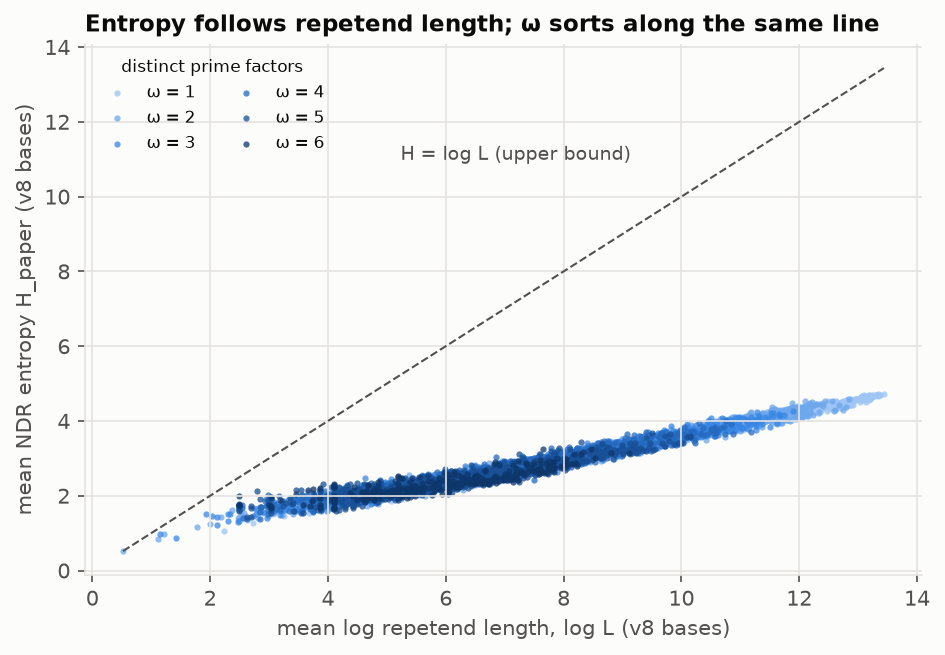

# Sieve Echo v11 — claim verdicts (scale-s0-step14)

- **Run:** `scale-s0-step14`, config `empirical-scripts/11.0/config/scale.json` (sha256 `5512d8974d`), seed 0.
- **Code:** root `3b64d0b4dc` (dirty), libs/evolvo `d2111859f0`, v11 sources sha256 `929b99da4e`.
- **Definitions:** `None`; primary base set `None`; entropies .
- **Data:** 41074 integers, 783040 coprime (n, b) pairs; split {'train': 28752, 'val': 6160, 'test': 6162} (split sha256 `9789b5b2e5`).
- **Inference:** None bootstrap resamples (95% percentile CIs over test rows), None permutations; effect threshold None (ΔR², η² excess, r²).

Paper statistics are re-computed the way the v8.2 code computed them (in-sample, `H_v8`, n ∈ [2, 9999]); corrected tests fit on the train split and report on the test split.

## Figures

*Test-split integers: mean H_paper against mean log L, coloured by ω. Points with more prime factors sit lower because their repetends are shorter, not off the H–log L curve (claims C1, C9).*

## Verdicts

No `claims` stage in this run; see the sections below.

## Step 14 — Exact subgroup membership and the C7 residue structure

Primary-set bases [2, 3, 4, 5, 6, 7, 9, 10, 11, 13, 14, 15, 16]; q ∈ {2, 3, 5, 7, 11, 13} and the 25 primes below 100. (ℤ/nℤ)* is cyclic for 21.5% of the rows; in the non-cyclic groups [ord q | ord b] holds for 2419419 (row, b, q) cells, of which 1893459 (78.3%) have q ∉ ⟨b⟩.

Residue-class η² excess over the permutation null on the test residuals:

**H_paper** (6155 test rows)

| controls | columns | mod 6 | mod 12 | mod 30 | mod 210 |
| --- | --- | --- | --- | --- | --- |
| C7 + Midy + zeros | 0 | 0.0023 † | 0.0217 | 0.0142 | 0.0319 |
| + [ord q | ord b], q ≤ 13 (step 9a) | 72 | 0.0011 † | 0.0109 | 0.0123 | 0.0227 |
| + exact q ∈ ⟨b⟩, q ≤ 13 | 72 | 0.0009 † | 0.0131 | 0.0169 | 0.0331 |
| + [ord q | ord b], q < 100 | 319 | 0.0005 † | 0.0111 | 0.0128 | 0.0191 |
| + exact q ∈ ⟨b⟩, q < 100 | 319 | 0.0010 † | 0.0123 | 0.0190 | 0.0304 |
| + exact q ∈ ⟨b⟩ and −q ∈ ⟨b⟩, q ≤ 13 | 144 | 0.0008 † | 0.0119 | 0.0159 | 0.0309 |
| + exact ±q ∈ ⟨b⟩ (q ≤ 13) + [ord q | ord b] (q < 100) | 463 | 0.0006 † | 0.0099 † | 0.0121 | 0.0180 |
| diagnostic: … + joint coprimality pattern (labelled) | 62 | 0.0006 † | 0.0076 † | 0.0026 † | 0.0029 † |
| diagnostic: … + pattern + min(v₂(n), 3) (labelled) | 65 | 0.0010 † | 0.0022 † | 0.0025 † | 0.0030 † |
| diagnostic: C7 + Midy + zeros + pattern + min(v₂(n), 3), no membership | 65 | 0.0025 † | 0.0065 † | 0.0067 † | 0.0104 |

† not supported: excess below the C7 effect threshold or permutation p ≥ 0.01. The first two diagnostic rows add the listed columns to the ±q, q < 100 row; the last adds them to C7 + Midy + zeros.

With the ±q and q < 100 controls, excess by prime-power modulus: mod 3 0.0001 (p 0.303), mod 4 0.0069 (p 0.002), mod 8 0.0104 (p 0.002), mod 5 0.0005 (p 0.124), mod 7 0.0001 (p 0.361).
Mean test residual by n mod 12: 0: -0.0218 (712), 1: -0.0058 (520), 2: -0.0071 (435), 3: -0.0020 (404), 4: -0.0030 (394), 5: -0.0015 (549), 6: +0.0164 (897), 7: +0.0052 (502), 8: -0.0091 (395), 9: -0.0055 (403), 10: +0.0167 (389), 11: +0.0049 (555).

**H_nodc** (6155 test rows)

| controls | columns | mod 6 | mod 12 | mod 30 | mod 210 |
| --- | --- | --- | --- | --- | --- |
| C7 + Midy + zeros | 0 | 0.0017 † | 0.0325 | 0.0063 † | 0.0153 |
| + [ord q | ord b], q ≤ 13 (step 9a) | 72 | 0.0008 † | 0.0202 | 0.0056 † | 0.0105 |
| + exact q ∈ ⟨b⟩, q ≤ 13 | 72 | 0.0008 † | 0.0232 | 0.0066 † | 0.0135 |
| + [ord q | ord b], q < 100 | 319 | 0.0003 † | 0.0231 | 0.0064 † | 0.0060 † |
| + exact q ∈ ⟨b⟩, q < 100 | 319 | 0.0008 † | 0.0220 | 0.0081 † | 0.0089 † |
| + exact q ∈ ⟨b⟩ and −q ∈ ⟨b⟩, q ≤ 13 | 144 | 0.0005 † | 0.0217 | 0.0059 † | 0.0106 |
| + exact ±q ∈ ⟨b⟩ (q ≤ 13) + [ord q | ord b] (q < 100) | 463 | 0.0003 † | 0.0211 | 0.0057 † | 0.0042 † |
| diagnostic: … + joint coprimality pattern (labelled) | 62 | 0.0002 † | 0.0171 | 0.0035 † | -0.0030 † |
| diagnostic: … + pattern + min(v₂(n), 3) (labelled) | 65 | 0.0006 † | 0.0022 † | 0.0032 † | -0.0023 † |
| diagnostic: C7 + Midy + zeros + pattern + min(v₂(n), 3), no membership | 65 | 0.0021 † | 0.0063 † | 0.0059 † | 0.0048 † |

† not supported: excess below the C7 effect threshold or permutation p ≥ 0.01. The first two diagnostic rows add the listed columns to the ±q, q < 100 row; the last adds them to C7 + Midy + zeros.

With the ±q and q < 100 controls, excess by prime-power modulus: mod 3 0.0000 (p 0.405), mod 4 0.0157 (p 0.002), mod 8 0.0213 (p 0.002), mod 5 0.0011 (p 0.036), mod 7 -0.0002 (p 0.595).
Mean test residual by n mod 12: 0: -0.1236 (712), 1: -0.0270 (520), 2: +0.0096 (435), 3: +0.0097 (404), 4: -0.0062 (394), 5: -0.0187 (549), 6: +0.0839 (897), 7: +0.0128 (502), 8: -0.0306 (395), 9: -0.0205 (403), 10: +0.0642 (389), 11: +0.0092 (555).

Full numbers: `subgroup.json` in this run directory.
