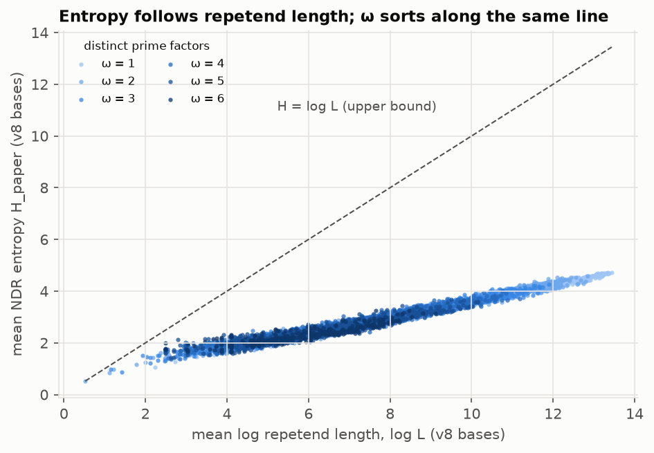
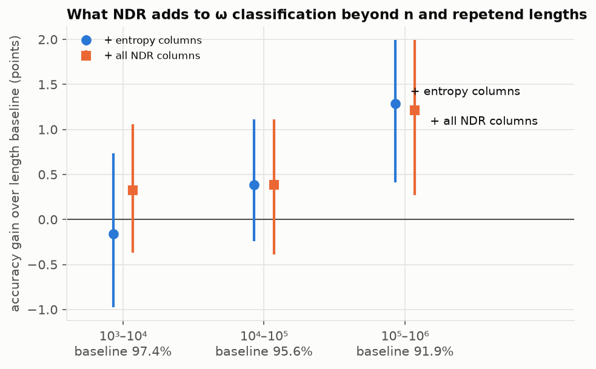
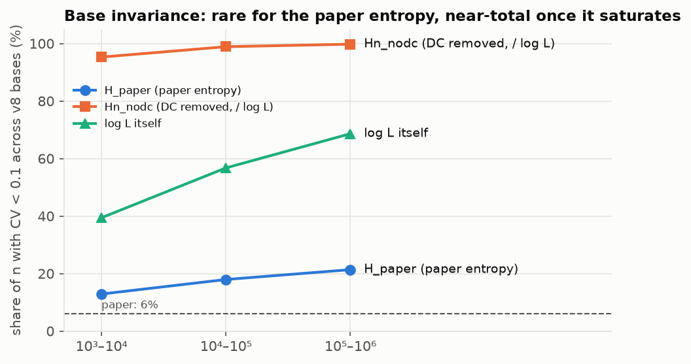
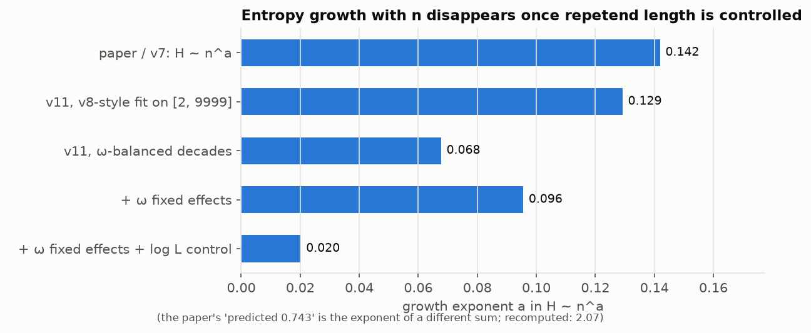
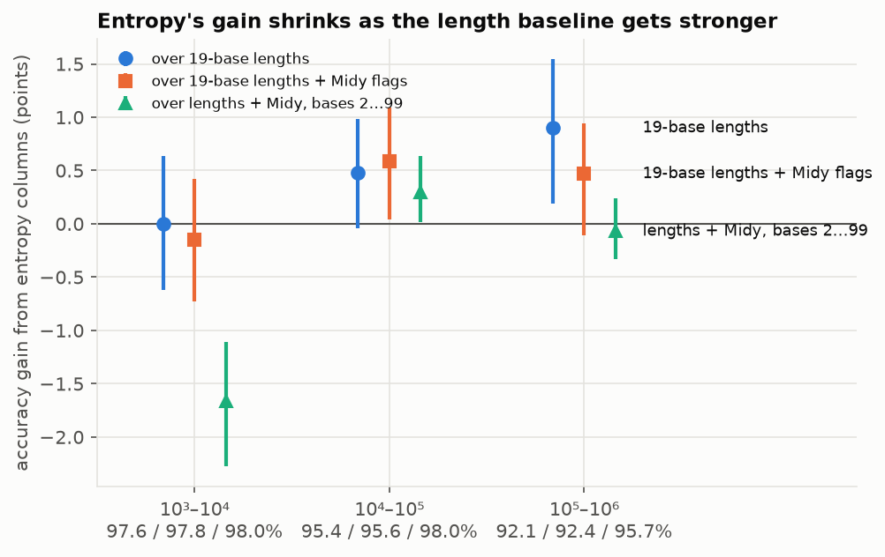
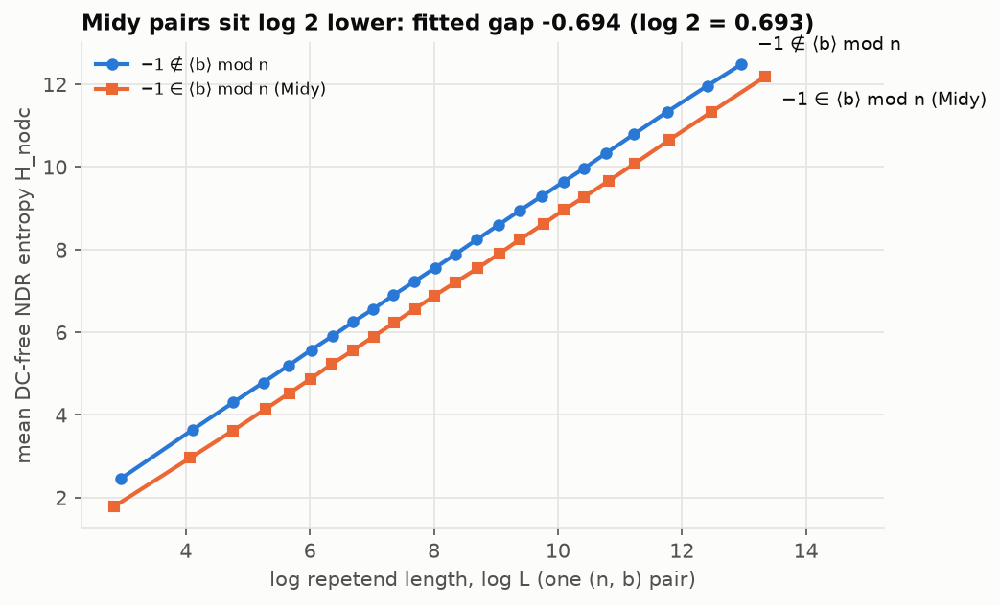

# Sieve Echo v11 — claim verdicts (scale-s0-step7)

- **Run:** `scale-s0-step7`, config `empirical-scripts/11.0/config/scale.json` (sha256 `a09ac9d114`), seed 0.
- **Code:** root `2ab1de150b` (dirty), libs/evolvo `d2111859f0`, v11 sources sha256 `c66614e5b4`.
- **Definitions:** `ndr-v11.1`; primary base set `v8`; entropies `H_paper`, `H_nodc`, `Hn_paper`.
- **Data:** 41074 integers, 783040 coprime (n, b) pairs; split {'train': 28752, 'val': 6160, 'test': 6162} (split sha256 `9789b5b2e5`).
- **Inference:** 1000 bootstrap resamples (95% percentile CIs over test rows), 1000 permutations; effect threshold 0.01 (ΔR², η² excess, r²).

Paper statistics are re-computed the way the v8.2 code computed them (in-sample, `H_v8`, n ∈ [2, 9999]); corrected tests fit on the train split and report on the test split.

## Figures

*Test-split integers: mean H_paper against mean log L, coloured by ω. Points with more prime factors sit lower because their repetends are shorter, not off the H–log L curve (claims C1, C9).*

*Held-out gain (95% bootstrap CI) of gradient boosting when entropy or all NDR columns are added to the baseline of n, per-base repetend lengths and their lcm arithmetic, per ω-balanced n-range (step 5).*

*Share of integers whose statistic varies by less than 10% (CV) across the v8 bases, per ω-balanced n-range (claim C4, step 5).*

*Growth exponents of the NDR entropy with n, with and without ω and log L controls (step 5).*

*Held-out gain (95% bootstrap CI) from adding the entropy columns to three length baselines, per ω-balanced n-range; tick labels give the baselines' own accuracies in the same order (step 7a).*

*Test-split (n, b) pairs of the 19 v8/v10/primes31 bases: mean H_nodc per log L bin, split by the Midy flag b^(L/2) ≡ −1 (mod n). When it holds the two halves of the repetend are digit complements and every even DFT bin except DC vanishes (step 7b).*

## Verdicts

| Claim | Paper says | Paper statistic re-computed | Corrected test (held out, with controls) | Verdict |
| --- | --- | --- | --- | --- |
| **C1** Sieve Echo Law H = α·log ω + β (§2.2) | H_NDR = -0.468·log(ω) + 1.917, R² = 0.234 | reproduced | H_paper: test R² law-only 0.298, baseline (log L, log n) 0.971, full 0.972; ΔR² 0.0005 CI [0.000, 0.001] (threshold 0.01); partial r(H, log ω \| log L, log n) -0.135. | **reproduced but explained by size/length** |
| **C2** Direction of the effect (§1.3, §7.1) | §1.3: primes give 'pure, low-entropy' patterns; §7.1: 'higher complexity correlates with higher entropy'; §2.2: α < 0 | reproduced | Measured on test (H_paper): primes minus composites mean H = 0.902 CI [0.860, 0.946]; Spearman(H, ω) -0.515 (negative); given log L and log n the sign is negative. Primes have the highest entropy, so §1.3 ('primes low-e… | **not supported** |
| **C3** Prime-power dichotomy (§2.3) | strongest predictor of NDR entropy is prime-power status, r = -0.843 | not reproduced | The paper's -0.843 is corr(ω, is_prime_power) (v11: -0.655 on [2, 9999]), not an entropy correlation. Actual r(H, prime power) on test = 0.468 (positive: prime powers have higher H); given log L, log n: -0.057 CI [-0.08… | **not reproduced** |
| **C4** Base invariance CV < 0.1 (§2.4, Q5.2) | base invariance in only 6% of cases | reproduced | v8.2's 6% is a 100-integer sample (v11 on all n in [2, 9999]: 0.091). Spearman(CV, log n) for v8/H_paper: -0.102 CI [-0.111, -0.093]. Highest overall rate: v8/Hn_nodc = 0.977. Normalized DC-free entropy saturates near i… | **reproduced; invariance increases with n** |
| **C5** Correlation with n^-s (zeta, §4.1) | H correlates with n^-s, decreasing in s (zeta connection) | reproduced | n^-s is a monotone function of n; after a cubic in log n the partial correlations are s=2: -0.011, s=3: -0.011, s=4: -0.010; H ~ log n alone has test R² 0.334. | **reproduced but explained by size/length** |
| **C6** H·log n vs prime number theorem (§4.2) | corr(H·log n, H) = 0.946 links NDR entropy to the PNT | reproduced | corr(H·log n, H) = 0.946; with H randomly permuted across n the same statistic is 0.831 CI [0.826, 0.836]: most of it comes from H appearing on both sides, the rest from H growing with n (corr(H, log n) = 0.593). PNT/Li… | **reproduced but explained by size/length** |
| **C7** Residue-class structure mod 6/12/30/210 (§4.3) | variance of residue-class mean H > 0.01 marks significant modular structure | reproduced | η² of residue class on test, raw → excess over the permutation null after controls. H_paper: mod 6: 0.270 → excess 0.002 (p 0.018), mod 12: 0.283 → excess 0.035 (p 0.002), mod 30: 0.306 → excess 0.016 (p 0.002), mod 210… | **supported (residue structure beyond per-base L and ω)** |
| **C8** Fitted constants vs theory and constant matching (§5) | α ≈ -0.468 ≈ tribonacci - ln 10, β ≈ 1.917 ≈ 1/φ² + ln 10; theory α = -1.599, β = 4.933 | reproduced | Theory constants inside a 95% CI: no. A value drawn at random near α matches some library combination within 0.01 with probability 0.87 (near β: 0.88), so the matches carry no evidence; α and β also change with log(ω) v… | **not supported** |
| **C9** Information about ω beyond L and n (core question) | NDR entropy patterns encode factorization complexity (Conj. 1.3) | n/a | Held-out ω classification: baseline (n, per-base L, lcm arithmetic) accuracy 0.956; +entropy features 0.960 (Δ +0.005 CI [0.000, 0.009]); +all NDR features 0.965 (Δ +0.009 CI [0.004, 0.014], log-loss gain +0.0200 CI [0.… | **supported** |

## C1 — Sieve Echo Law H = α·log ω + β (§2.2)

- **Paper:** H_NDR = -0.468·log(ω) + 1.917, R² = 0.234
- **Re-computed paper statistic (reproduced):** {"statistic": "OLS of v8-set mean H_v8 on log(omega+1), n in [2, 9999], in-sample", "paper": {"alpha": -0.4681, "beta": 1.9174, "r2": 0.2345}, "v11": {"log(omega+1) [v8.2 code]": {"alpha": -0.4681, "beta": 1.9174, "r2": 0.2345}, "log(omega) [paper text]": {"alpha": -0.3047, "beta": 1.6049, "r2": 0.2288}}}
- **Corrected test:** H_paper: test R² law-only 0.298, baseline (log L, log n) 0.971, full 0.972; ΔR² 0.0005 CI [0.000, 0.001] (threshold 0.01); partial r(H, log ω | log L, log n) -0.135.
- **Verdict:** reproduced but explained by size/length

## C2 — Direction of the effect (§1.3, §7.1)

- **Paper:** §1.3: primes give 'pure, low-entropy' patterns; §7.1: 'higher complexity correlates with higher entropy'; §2.2: α < 0
- **Re-computed paper statistic (reproduced):** {"statistic": "sign of α in C1", "note": "α < 0 in the stored v8.2 fit"}
- **Corrected test:** Measured on test (H_paper): primes minus composites mean H = 0.902 CI [0.860, 0.946]; Spearman(H, ω) -0.515 (negative); given log L and log n the sign is negative. Primes have the highest entropy, so §1.3 ('primes low-entropy') and §7.1 item 2 are contradicted; only α < 0 holds.
- **Verdict:** not supported

## C3 — Prime-power dichotomy (§2.3)

- **Paper:** strongest predictor of NDR entropy is prime-power status, r = -0.843
- **Re-computed paper statistic (not reproduced):** {"statistic": "paper r = -0.843; source: v7.0 log line 210 `omega_vs_is_prime_power` (two factorization labels)", "paper": -0.843, "v11": {"corr(omega, is_prime_power), n in [2, 9999]": -0.6551, "corr(H_v8 mean, is_prime_power), n in [2, 9999]": 0.3311}, "note": "-0.843 is not an entropy statistic; its exact v7 sample is unknown."}
- **Corrected test:** The paper's -0.843 is corr(ω, is_prime_power) (v11: -0.655 on [2, 9999]), not an entropy correlation. Actual r(H, prime power) on test = 0.468 (positive: prime powers have higher H); given log L, log n: -0.057 CI [-0.080, -0.035].
- **Verdict:** not reproduced

## C4 — Base invariance CV < 0.1 (§2.4, Q5.2)

- **Paper:** base invariance in only 6% of cases
- **Re-computed paper statistic (reproduced):** {"statistic": "share of n with CV(H_v8 over v8 bases) < 0.1", "v11": {"paper": 0.06, "v11 first 100 of v8.2 data order": 0.06, "v11 all n in [2, 9999]": 0.0913}, "note": "v8.2 evaluated only data[:100]."}
- **Corrected test:** v8.2's 6% is a 100-integer sample (v11 on all n in [2, 9999]: 0.091). Spearman(CV, log n) for v8/H_paper: -0.102 CI [-0.111, -0.093]. Highest overall rate: v8/Hn_nodc = 0.977. Normalized DC-free entropy saturates near its maximum for long, noise-like repetends, so its CV shrinks with L; the CV of log L itself also falls with n.
- **Verdict:** reproduced; invariance increases with n

## C5 — Correlation with n^-s (zeta, §4.1)

- **Paper:** H correlates with n^-s, decreasing in s (zeta connection)
- **Re-computed paper statistic (reproduced):** {"statistic": "corr(n^-s, v8 mean H_v8) over v8.2 data[:100]", "v11": {"paper": {"2": -0.4407, "3": -0.3373, "4": -0.2892}, "v11 first 100 of v8.2 data order": {"2": -0.4407, "3": -0.3373, "4": -0.2892}, "v11 all n in [2, 9999]": {"2": -0.1143, "3": -0.0825, "4": -0.07}}}
- **Corrected test:** n^-s is a monotone function of n; after a cubic in log n the partial correlations are s=2: -0.011, s=3: -0.011, s=4: -0.010; H ~ log n alone has test R² 0.334.
- **Verdict:** reproduced but explained by size/length

## C6 — H·log n vs prime number theorem (§4.2)

- **Paper:** corr(H·log n, H) = 0.946 links NDR entropy to the PNT
- **Re-computed paper statistic (reproduced):** {"statistic": "corr(H·log n, H) over n in [3, 9999], v8 mean H_v8", "paper": {"pnt_entropy_product": 0.9465, "pnt_error": 0.5199, "li_error": 0.4959}, "v11": {"pnt_entropy_product": 0.9465, "pnt_error": 0.5199, "li_error": 0.4959}, "null_permuted_H": {"pnt_entropy_product_mean": 0.8307, "ci95": [0.8257, 0.8359]}}
- **Corrected test:** corr(H·log n, H) = 0.946; with H randomly permuted across n the same statistic is 0.831 CI [0.826, 0.836]: most of it comes from H appearing on both sides, the rest from H growing with n (corr(H, log n) = 0.593). PNT/Li errors are functions of n; partial r given log n: pnt -0.002, li -0.014.
- **Verdict:** reproduced but explained by size/length

## C7 — Residue-class structure mod 6/12/30/210 (§4.3)

- **Paper:** variance of residue-class mean H > 0.01 marks significant modular structure
- **Re-computed paper statistic (reproduced):** {"statistic": "variance of residue-class means of v8 mean H_v8, n in [2, 9999]", "paper": {"6": 0.0153, "12": 0.0169, "30": 0.018, "210": 0.0205}, "v11": {"6": 0.0153, "12": 0.0169, "30": 0.018, "210": 0.0205}}
- **Corrected test:** η² of residue class on test, raw → excess over the permutation null after controls. H_paper: mod 6: 0.270 → excess 0.002 (p 0.018), mod 12: 0.283 → excess 0.035 (p 0.002), mod 30: 0.306 → excess 0.016 (p 0.002), mod 210: 0.346 → excess 0.034 (p 0.002). H_nodc: mod 6: 0.191 → excess 0.001 (p 0.066), mod 12: 0.209 → excess 0.037 (p 0.002), mod 30: 0.237 → excess 0.006 (p 0.002), mod 210: 0.286 → excess 0.015 (p 0.002). Residues mod 6/12/30/210 fix divisibility by 2, 3, 5, 7 and the quadratic characters of the bases, which set the per-base orders.
- **Verdict:** supported (residue structure beyond per-base L and ω)

## C8 — Fitted constants vs theory and constant matching (§5)

- **Paper:** α ≈ -0.468 ≈ tribonacci - ln 10, β ≈ 1.917 ≈ 1/φ² + ln 10; theory α = -1.599, β = 4.933
- **Re-computed paper statistic (reproduced):** {"statistic": "v8.2 constant matching: 20 constants, singles and pairwise sums/differences, \|error\| < 0.01", "look_elsewhere": {"stored_match": "tribonacci - ln_10", "stored_match_value": -0.4633, "reproduced_alpha": -0.4681, "matches_within_0.01_of_reproduced_alpha": 1, "library_size": 20, "candidate_values": 605, "tolerance": 0.01, "chance_match_probability_near_alpha": 0.871, "chance_match_probability_near_beta": 0.8828}}
- **Corrected test:** Theory constants inside a 95% CI: no. A value drawn at random near α matches some library combination within 0.01 with probability 0.87 (near β: 0.88), so the matches carry no evidence; α and β also change with log(ω) vs log(ω+1) and with the entropy definition.
- **Verdict:** not supported

## C9 — Information about ω beyond L and n (core question)

- **Paper:** NDR entropy patterns encode factorization complexity (Conj. 1.3)
- **Re-computed paper statistic (n/a):** {"statistic": "no paper statistic controls for L"}
- **Corrected test:** Held-out ω classification: baseline (n, per-base L, lcm arithmetic) accuracy 0.956; +entropy features 0.960 (Δ +0.005 CI [0.000, 0.009]); +all NDR features 0.965 (Δ +0.009 CI [0.004, 0.014], log-loss gain +0.0200 CI [0.010, 0.028]); majority 0.246, shuffled-label null 0.238.
- **Verdict:** supported

## Step 5 — Scale (per n-range, ω-balanced samples)

Each range: at most 3000 integers per ω (ω strata with < 30 dropped); fits on the range's train rows, statistics on its test rows; 500 bootstrap resamples. Entropy `v8.H_paper`.

| n range | rows (test) | C1 ΔR² of log ω [CI] | C1 partial r | C2 Spearman(H, ω) | C3 partial r | C4 invariance H / Hn_nodc / log L | C9 acc base → +entropy → +all NDR |
| --- | --- | --- | --- | --- | --- | --- | --- |
| 1000–9999 | 7991 (1230) | +0.0007 [-0.000, +0.002] | -0.083 | -0.642 | -0.024 | 0.129 / 0.953 / 0.394 | 0.9740 → 0.9724 → 0.9772 (Δentropy [-0.010, +0.007]) |
| 10000–99999 | 13783 (2072) | +0.0008 [+0.000, +0.001] | -0.137 | -0.831 | -0.043 | 0.179 / 0.989 / 0.567 | 0.9556 → 0.9595 → 0.9595 (Δentropy [-0.002, +0.011]) |
| 100000–1000000 | 17260 (2555) | +0.0014 [+0.001, +0.002] | -0.215 | -0.869 | -0.014 | 0.214 / 0.998 / 0.686 | 0.9191 → 0.9320 → 0.9313 (Δentropy [+0.004, +0.020]) |

**Stability between the last two ranges:**

- C1: explained by size/length → explained by size/length — **stable**
- C2: negative → negative — **stable**
- C3: negligible → negligible — **stable**
- C4: rare (< 50%) → rare (< 50%) — **stable**
- C9: entropy adds nothing; NDR adds nothing → entropy adds; NDR adds — **drift**

**Growth exponents** (paper: H ~ n^0.142, 'predicted' 0.743):

- v8-style `H_v8` on all n in [2, 9999]: H ≈ 0.460·n^0.129
- ω-balanced ranges, `H_paper`: a = 0.068; with ω fixed effects 0.096; adding log(log L) as control: a = 0.020, b = 0.609
- per-ω exponent: ω=1: 0.089, ω=2: 0.097, ω=3: 0.099, ω=4: 0.096, ω=5: 0.092, ω=6: 0.088
- T(x) = Σ_p Σ_n log ord_n(p) for x = [100, 200, 400, 800, 1600, 3200]: exponent 2.074 (local 2.21, 2.04, 2.07, 2.06, 2.03); the term count alone grows like x²/log x.

## Step 7 — Stronger length baselines, Midy symmetry, λ(n)

Orders ord_n(b) and Midy flags [b^(L/2) ≡ −1 (mod n)] for bases 2..99 (98 bases) and every integer; L19 = n + per-base L + length arithmetic over the 19 v8/v10/primes31 bases (the step-5 baseline), L98 = the same over all length bases. Same ω-balanced samples and GBM settings as step 5; per-row correctness averaged over 5 GBM seed(s) (the first reproduces step 5); 500 paired bootstrap resamples over test rows.

**7a — accuracy of each baseline, and the gain from adding the entropy columns** (Δ in points, 95% CI):

| n range | test rows | L19 | L19 + Midy19 | L98 | L98 + Midy98 |
| --- | --- | --- | --- | --- | --- |
| 1000–9999 | 1230 | 0.9758 → 0.9758 (Δ +0.00 [-0.618, +0.634]) | 0.9784 → 0.9769 (Δ -0.15 [-0.724, +0.423]) | 0.9702 → 0.9577 (Δ -1.25 [-1.813, -0.715]) | 0.9800 → 0.9634 (Δ -1.66 [-2.276, -1.106]) |
| 10000–99999 | 2072 | 0.9540 → 0.9588 (Δ +0.48 [-0.044, +0.985]) | 0.9558 → 0.9617 (Δ +0.59 [+0.043, +1.091]) | 0.9784 → 0.9806 (Δ +0.22 [-0.097, +0.565]) | 0.9801 → 0.9831 (Δ +0.30 [+0.014, +0.632]) |
| 100000–1000000 | 2560 | 0.9205 → 0.9295 (Δ +0.90 [+0.191, +1.543]) | 0.9238 → 0.9285 (Δ +0.47 [-0.106, +0.942]) | 0.9531 → 0.9545 (Δ +0.14 [-0.219, +0.500]) | 0.9568 → 0.9561 (Δ -0.07 [-0.329, +0.242]) |

Baseline differences (points, 95% CI): 
- 1000–9999: L19 + Midy19 vs L19 +0.26 [-0.016, +0.529]; L98 vs L19 -0.55 [-1.302, +0.220]; L98 + Midy98 vs L98 +0.98 [+0.544, +1.415]; L98 + Midy98 vs L19 +0.42 [-0.276, +1.171]; all NDR over L98 + Midy98: -2.07 [-2.667, -1.471]
- 10000–99999: L19 + Midy19 vs L19 +0.18 [-0.082, +0.463]; L98 vs L19 +2.44 [+1.766, +3.210]; L98 + Midy98 vs L98 +0.17 [-0.019, +0.386]; L98 + Midy98 vs L19 +2.62 [+1.906, +3.277]; all NDR over L98 + Midy98: +0.26 [-0.116, +0.638]
- 100000–1000000: L19 + Midy19 vs L19 +0.33 [-0.051, +0.664]; L98 vs L19 +3.26 [+2.433, +4.133]; L98 + Midy98 vs L98 +0.37 [+0.090, +0.645]; L98 + Midy98 vs L19 +3.62 [+2.851, +4.457]; all NDR over L98 + Midy98: +0.13 [-0.340, +0.586]

**NDR feature families** on 100000–1000000 (2560 test rows): gain in points over L19 / over L19 + Midy19

| family | columns | over L19 | over L19 + Midy19 |
| --- | --- | --- | --- |
| H_paper | 15 | -0.19 [-0.536, +0.172] | -0.35 [-0.660, -0.047] |
| H_nodc | 15 | +0.05 [-0.266, +0.371] | -0.16 [-0.520, +0.164] |
| Hn_paper | 15 | +0.40 [-0.063, +0.828] | +0.02 [-0.363, +0.387] |
| Hn_nodc | 15 | +1.02 [+0.461, +1.617] | +0.48 [-0.113, +1.031] |
| mean | 15 | -0.25 [-0.563, +0.047] | -0.22 [-0.531, +0.102] |
| std | 15 | +0.34 [-0.035, +0.746] | +0.33 [-0.090, +0.742] |
| skew | 15 | +0.57 [+0.113, +1.047] | +0.41 [-0.098, +0.922] |
| kurt | 15 | -0.10 [-0.414, +0.246] | -0.05 [-0.383, +0.278] |
| flatness | 15 | +1.18 [+0.602, +1.812] | +0.73 [+0.219, +1.254] |
| H_v8 | 15 | -0.20 [-0.531, +0.117] | -0.02 [-0.309, +0.242] |
| H_v10 | 15 | +0.07 [-0.246, +0.352] | -0.23 [-0.570, +0.082] |

**7b — pair-level mechanism** (783040 pairs; orders match the dataset's pair table: True). Share of Midy pairs 0.256; by ω: ω=1: 0.615, ω=2: 0.206, ω=3: 0.076, ω=4: 0.029, ω=5: 0.010, ω=6: 0.003.

| entropy | test R² (log L, log b, log n) | + Midy flag | residual variance explained | Midy coefficient (log 2 = 0.693) |
| --- | --- | --- | --- | --- |
| H_nodc | 0.9864 | 0.9976 | 0.822 | -0.694 |
| H_paper | 0.8832 | 0.8903 | 0.061 | -0.182 |

**C7 residues with Midy controls** — C7 controls (log n, per-base log L, coprimality, ω dummies as labelled control); then + Midy flag of each v8 base. Excess η² over the permutation null (p):

| entropy | modulus | C7 controls | + Midy flags |
| --- | --- | --- | --- |
| H_paper | 6 | +0.0016 (p 0.008) | +0.0020 (p 0.002) |
| H_paper | 12 | +0.0351 (p 0.002) | +0.0218 (p 0.002) |
| H_paper | 30 | +0.0153 (p 0.002) | +0.0144 (p 0.002) |
| H_paper | 210 | +0.0338 (p 0.002) | +0.0314 (p 0.002) |
| H_nodc | 6 | +0.0008 (p 0.070) | +0.0011 (p 0.032) |
| H_nodc | 12 | +0.0367 (p 0.002) | +0.0321 (p 0.002) |
| H_nodc | 30 | +0.0062 (p 0.002) | +0.0061 (p 0.002) |
| H_nodc | 210 | +0.0148 (p 0.002) | +0.0132 (p 0.002) |

**7c — λ(n) and ω** (λ and φ are labels: diagnostics and a labelled control only)

- lcm of the orders = λ(n): 19 bases 1.0000, bases 2..99 1.0000 of all integers (lcm always divides λ: True).
- Theorem 1.3 on 19390 odd n: 0 violations. Length-only bound ω ≤ ceil(log2(n / lcm98)) (odd n; from Theorem 1.3 with φ < n and lcm98 ≤ λ): 0 violations, tight for 0.644, mean slack 0.81.

| n range | lcm19 = λ | lcm98 = λ | log n, log λ (labelled factorization-derived control) | log n, log lcm98 | log n, log lcm98, Midy share 98 |
| --- | --- | --- | --- | --- | --- |
| 1000–9999 | 1.0000 | 1.0000 | 0.7338 | 0.7338 | 0.7774 |
| 10000–99999 | 1.0000 | 1.0000 | 0.6887 | 0.6887 | 0.7527 |
| 100000–1000000 | 1.0000 | 1.0000 | 0.7170 | 0.7170 | 0.7643 |

**Evolvo formulas for ω** (whole table; guides ['none', 'policy'], seeds [0, 1, 2], population 120 × 40 generations; selection on validation, one test read):

| inputs | mean test accuracy (sd) | best by validation: test accuracy | expression |
| --- | --- | --- | --- |
| step-4 inputs (19 bases + entropy) | 0.5823 (0.0927) | 0.6809 | `([log n - log lcm] + (2.71828 - (2.71828 % sin((2.71828 - cos(exp(cos([share of L_b dividing n-1]))))))))` |
| lengths 2..99 + Midy share | 0.5391 (0.0650) | 0.4984 | `((2 - -1) + [row.len98.log n - log lcm])` |

Full numbers: `claims.json`, `scale.json`, `lengths.json` in this run directory.
