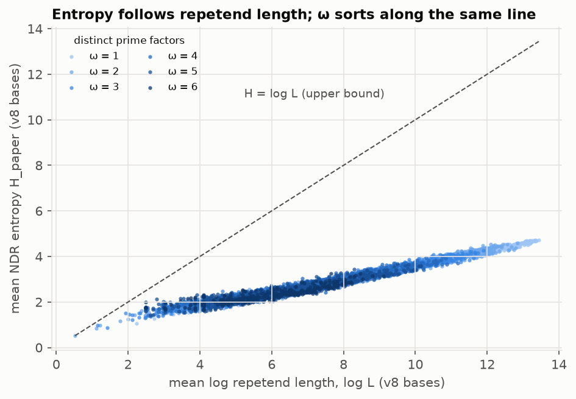
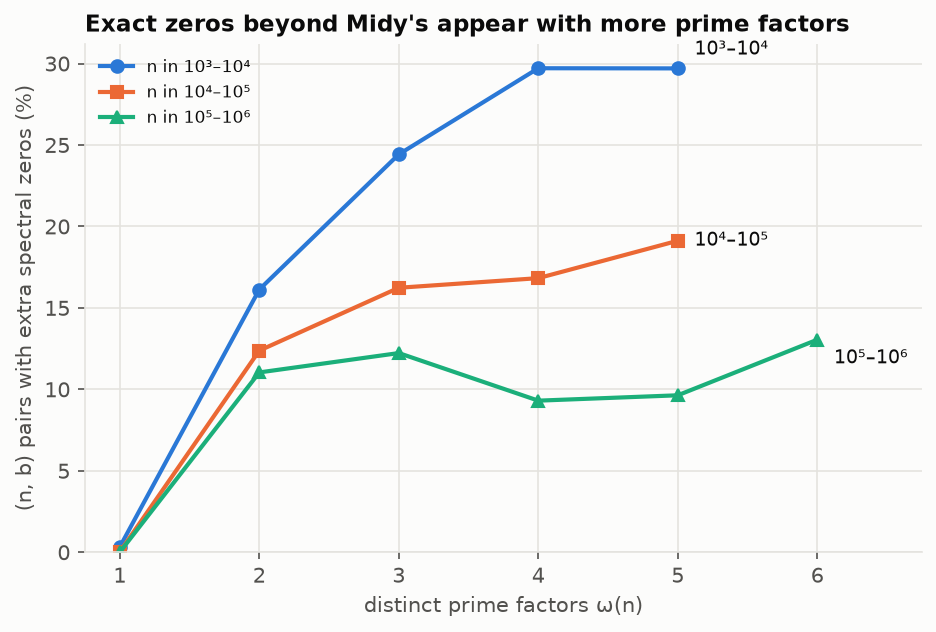

# Sieve Echo v11 — claim verdicts (scale-s0-step8)

- **Run:** `scale-s0-step8`, config `empirical-scripts/11.0/config/scale.json` (sha256 `35b72dfb5b`), seed 0.
- **Code:** root `5570ad3b25` (dirty), libs/evolvo `d2111859f0`, v11 sources sha256 `bed7380944`.
- **Definitions:** `ndr-v11.1`; primary base set `v8`; entropies `H_paper`, `H_nodc`, `Hn_paper`.
- **Data:** 41074 integers, 783040 coprime (n, b) pairs; split {'train': 28752, 'val': 6160, 'test': 6162} (split sha256 `9789b5b2e5`).
- **Inference:** 1000 bootstrap resamples (95% percentile CIs over test rows), 1000 permutations; effect threshold 0.01 (ΔR², η² excess, r²).

Paper statistics are re-computed the way the v8.2 code computed them (in-sample, `H_v8`, n ∈ [2, 9999]); corrected tests fit on the train split and report on the test split.

## Figures

*Test-split integers: mean H_paper against mean log L, coloured by ω. Points with more prime factors sit lower because their repetends are shorter, not off the H–log L curve (claims C1, C9).*

*Share of (n, b) pairs (19 v8/v10/primes31 bases) whose NDR spectrum has a vanishing frequency class other than Midy's even bins, by ω and n-range (step 8a). Imprimitive characters contribute Euler factors (1 − χ*(p)) that vanish at the prime factors of n.*

## Verdicts

| Claim | Paper says | Paper statistic re-computed | Corrected test (held out, with controls) | Verdict |
| --- | --- | --- | --- | --- |
| **C1** Sieve Echo Law H = α·log ω + β (§2.2) | H_NDR = -0.468·log(ω) + 1.917, R² = 0.234 | reproduced | H_paper: test R² law-only 0.298, baseline (log L, log n) 0.971, full 0.972; ΔR² 0.0005 CI [0.000, 0.001] (threshold 0.01); partial r(H, log ω \| log L, log n) -0.135. | **reproduced but explained by size/length** |
| **C2** Direction of the effect (§1.3, §7.1) | §1.3: primes give 'pure, low-entropy' patterns; §7.1: 'higher complexity correlates with higher entropy'; §2.2: α < 0 | reproduced | Measured on test (H_paper): primes minus composites mean H = 0.902 CI [0.860, 0.946]; Spearman(H, ω) -0.515 (negative); given log L and log n the sign is negative. Primes have the highest entropy, so §1.3 ('primes low-e… | **not supported** |
| **C3** Prime-power dichotomy (§2.3) | strongest predictor of NDR entropy is prime-power status, r = -0.843 | not reproduced | The paper's -0.843 is corr(ω, is_prime_power) (v11: -0.655 on [2, 9999]), not an entropy correlation. Actual r(H, prime power) on test = 0.468 (positive: prime powers have higher H); given log L, log n: -0.057 CI [-0.08… | **not reproduced** |
| **C4** Base invariance CV < 0.1 (§2.4, Q5.2) | base invariance in only 6% of cases | reproduced | v8.2's 6% is a 100-integer sample (v11 on all n in [2, 9999]: 0.091). Spearman(CV, log n) for v8/H_paper: -0.102 CI [-0.111, -0.093]. Highest overall rate: v8/Hn_nodc = 0.977. Normalized DC-free entropy saturates near i… | **reproduced; invariance increases with n** |
| **C5** Correlation with n^-s (zeta, §4.1) | H correlates with n^-s, decreasing in s (zeta connection) | reproduced | n^-s is a monotone function of n; after a cubic in log n the partial correlations are s=2: -0.011, s=3: -0.011, s=4: -0.010; H ~ log n alone has test R² 0.334. | **reproduced but explained by size/length** |
| **C6** H·log n vs prime number theorem (§4.2) | corr(H·log n, H) = 0.946 links NDR entropy to the PNT | reproduced | corr(H·log n, H) = 0.946; with H randomly permuted across n the same statistic is 0.831 CI [0.826, 0.836]: most of it comes from H appearing on both sides, the rest from H growing with n (corr(H, log n) = 0.593). PNT/Li… | **reproduced but explained by size/length** |
| **C7** Residue-class structure mod 6/12/30/210 (§4.3) | variance of residue-class mean H > 0.01 marks significant modular structure | reproduced | η² of residue class on test, raw → excess over the permutation null after controls. H_paper: mod 6: 0.270 → excess 0.002 (p 0.018), mod 12: 0.283 → excess 0.035 (p 0.002), mod 30: 0.306 → excess 0.016 (p 0.002), mod 210… | **supported (residue structure beyond per-base L and ω)** |
| **C8** Fitted constants vs theory and constant matching (§5) | α ≈ -0.468 ≈ tribonacci - ln 10, β ≈ 1.917 ≈ 1/φ² + ln 10; theory α = -1.599, β = 4.933 | reproduced | Theory constants inside a 95% CI: no. A value drawn at random near α matches some library combination within 0.01 with probability 0.87 (near β: 0.88), so the matches carry no evidence; α and β also change with log(ω) v… | **not supported** |
| **C9** Information about ω beyond L and n (core question) | NDR entropy patterns encode factorization complexity (Conj. 1.3) | n/a | Held-out ω classification: baseline (n, per-base L, lcm arithmetic) accuracy 0.956; +entropy features 0.960 (Δ +0.005 CI [0.000, 0.009]); +all NDR features 0.965 (Δ +0.009 CI [0.004, 0.014], log-loss gain +0.0200 CI [0.… | **supported** |

## C1 — Sieve Echo Law H = α·log ω + β (§2.2)

- **Paper:** H_NDR = -0.468·log(ω) + 1.917, R² = 0.234
- **Re-computed paper statistic (reproduced):** {"statistic": "OLS of v8-set mean H_v8 on log(omega+1), n in [2, 9999], in-sample", "paper": {"alpha": -0.4681, "beta": 1.9174, "r2": 0.2345}, "v11": {"log(omega+1) [v8.2 code]": {"alpha": -0.4681, "beta": 1.9174, "r2": 0.2345}, "log(omega) [paper text]": {"alpha": -0.3047, "beta": 1.6049, "r2": 0.2288}}}
- **Corrected test:** H_paper: test R² law-only 0.298, baseline (log L, log n) 0.971, full 0.972; ΔR² 0.0005 CI [0.000, 0.001] (threshold 0.01); partial r(H, log ω | log L, log n) -0.135.
- **Verdict:** reproduced but explained by size/length

## C2 — Direction of the effect (§1.3, §7.1)

- **Paper:** §1.3: primes give 'pure, low-entropy' patterns; §7.1: 'higher complexity correlates with higher entropy'; §2.2: α < 0
- **Re-computed paper statistic (reproduced):** {"statistic": "sign of α in C1", "note": "α < 0 in the stored v8.2 fit"}
- **Corrected test:** Measured on test (H_paper): primes minus composites mean H = 0.902 CI [0.860, 0.946]; Spearman(H, ω) -0.515 (negative); given log L and log n the sign is negative. Primes have the highest entropy, so §1.3 ('primes low-entropy') and §7.1 item 2 are contradicted; only α < 0 holds.
- **Verdict:** not supported

## C3 — Prime-power dichotomy (§2.3)

- **Paper:** strongest predictor of NDR entropy is prime-power status, r = -0.843
- **Re-computed paper statistic (not reproduced):** {"statistic": "paper r = -0.843; source: v7.0 log line 210 `omega_vs_is_prime_power` (two factorization labels)", "paper": -0.843, "v11": {"corr(omega, is_prime_power), n in [2, 9999]": -0.6551, "corr(H_v8 mean, is_prime_power), n in [2, 9999]": 0.3311}, "note": "-0.843 is not an entropy statistic; its exact v7 sample is unknown."}
- **Corrected test:** The paper's -0.843 is corr(ω, is_prime_power) (v11: -0.655 on [2, 9999]), not an entropy correlation. Actual r(H, prime power) on test = 0.468 (positive: prime powers have higher H); given log L, log n: -0.057 CI [-0.080, -0.035].
- **Verdict:** not reproduced

## C4 — Base invariance CV < 0.1 (§2.4, Q5.2)

- **Paper:** base invariance in only 6% of cases
- **Re-computed paper statistic (reproduced):** {"statistic": "share of n with CV(H_v8 over v8 bases) < 0.1", "v11": {"paper": 0.06, "v11 first 100 of v8.2 data order": 0.06, "v11 all n in [2, 9999]": 0.0913}, "note": "v8.2 evaluated only data[:100]."}
- **Corrected test:** v8.2's 6% is a 100-integer sample (v11 on all n in [2, 9999]: 0.091). Spearman(CV, log n) for v8/H_paper: -0.102 CI [-0.111, -0.093]. Highest overall rate: v8/Hn_nodc = 0.977. Normalized DC-free entropy saturates near its maximum for long, noise-like repetends, so its CV shrinks with L; the CV of log L itself also falls with n.
- **Verdict:** reproduced; invariance increases with n

## C5 — Correlation with n^-s (zeta, §4.1)

- **Paper:** H correlates with n^-s, decreasing in s (zeta connection)
- **Re-computed paper statistic (reproduced):** {"statistic": "corr(n^-s, v8 mean H_v8) over v8.2 data[:100]", "v11": {"paper": {"2": -0.4407, "3": -0.3373, "4": -0.2892}, "v11 first 100 of v8.2 data order": {"2": -0.4407, "3": -0.3373, "4": -0.2892}, "v11 all n in [2, 9999]": {"2": -0.1143, "3": -0.0825, "4": -0.07}}}
- **Corrected test:** n^-s is a monotone function of n; after a cubic in log n the partial correlations are s=2: -0.011, s=3: -0.011, s=4: -0.010; H ~ log n alone has test R² 0.334.
- **Verdict:** reproduced but explained by size/length

## C6 — H·log n vs prime number theorem (§4.2)

- **Paper:** corr(H·log n, H) = 0.946 links NDR entropy to the PNT
- **Re-computed paper statistic (reproduced):** {"statistic": "corr(H·log n, H) over n in [3, 9999], v8 mean H_v8", "paper": {"pnt_entropy_product": 0.9465, "pnt_error": 0.5199, "li_error": 0.4959}, "v11": {"pnt_entropy_product": 0.9465, "pnt_error": 0.5199, "li_error": 0.4959}, "null_permuted_H": {"pnt_entropy_product_mean": 0.8307, "ci95": [0.8257, 0.8359]}}
- **Corrected test:** corr(H·log n, H) = 0.946; with H randomly permuted across n the same statistic is 0.831 CI [0.826, 0.836]: most of it comes from H appearing on both sides, the rest from H growing with n (corr(H, log n) = 0.593). PNT/Li errors are functions of n; partial r given log n: pnt -0.002, li -0.014.
- **Verdict:** reproduced but explained by size/length

## C7 — Residue-class structure mod 6/12/30/210 (§4.3)

- **Paper:** variance of residue-class mean H > 0.01 marks significant modular structure
- **Re-computed paper statistic (reproduced):** {"statistic": "variance of residue-class means of v8 mean H_v8, n in [2, 9999]", "paper": {"6": 0.0153, "12": 0.0169, "30": 0.018, "210": 0.0205}, "v11": {"6": 0.0153, "12": 0.0169, "30": 0.018, "210": 0.0205}}
- **Corrected test:** η² of residue class on test, raw → excess over the permutation null after controls. H_paper: mod 6: 0.270 → excess 0.002 (p 0.018), mod 12: 0.283 → excess 0.035 (p 0.002), mod 30: 0.306 → excess 0.016 (p 0.002), mod 210: 0.346 → excess 0.034 (p 0.002). H_nodc: mod 6: 0.191 → excess 0.001 (p 0.066), mod 12: 0.209 → excess 0.037 (p 0.002), mod 30: 0.237 → excess 0.006 (p 0.002), mod 210: 0.286 → excess 0.015 (p 0.002). Residues mod 6/12/30/210 fix divisibility by 2, 3, 5, 7 and the quadratic characters of the bases, which set the per-base orders.
- **Verdict:** supported (residue structure beyond per-base L and ω)

## C8 — Fitted constants vs theory and constant matching (§5)

- **Paper:** α ≈ -0.468 ≈ tribonacci - ln 10, β ≈ 1.917 ≈ 1/φ² + ln 10; theory α = -1.599, β = 4.933
- **Re-computed paper statistic (reproduced):** {"statistic": "v8.2 constant matching: 20 constants, singles and pairwise sums/differences, \|error\| < 0.01", "look_elsewhere": {"stored_match": "tribonacci - ln_10", "stored_match_value": -0.4633, "reproduced_alpha": -0.4681, "matches_within_0.01_of_reproduced_alpha": 1, "library_size": 20, "candidate_values": 605, "tolerance": 0.01, "chance_match_probability_near_alpha": 0.871, "chance_match_probability_near_beta": 0.8828}}
- **Corrected test:** Theory constants inside a 95% CI: no. A value drawn at random near α matches some library combination within 0.01 with probability 0.87 (near β: 0.88), so the matches carry no evidence; α and β also change with log(ω) vs log(ω+1) and with the entropy definition.
- **Verdict:** not supported

## C9 — Information about ω beyond L and n (core question)

- **Paper:** NDR entropy patterns encode factorization complexity (Conj. 1.3)
- **Re-computed paper statistic (n/a):** {"statistic": "no paper statistic controls for L"}
- **Corrected test:** Held-out ω classification: baseline (n, per-base L, lcm arithmetic) accuracy 0.956; +entropy features 0.960 (Δ +0.005 CI [0.000, 0.009]); +all NDR features 0.965 (Δ +0.009 CI [0.004, 0.014], log-loss gain +0.0200 CI [0.010, 0.028]); majority 0.246, shuffled-label null 0.238.
- **Verdict:** supported

## Step 8 — Exact zeros of the NDR spectrum

Zero classes k | L (all bins j with L/gcd(j, L) = k vanish together) for 517642 pairs of bases [2, 3, 4, 5, 6, 7, 9, 10, 11, 12, 13, 14, 15, 16, 17, 19, 23, 29, 31]; float FFT of the remainders, threshold 1e-09 × mean non-DC power. Largest zero-class power / mean: 10^-24.8; smallest non-zero class power / mean: 10^-12.1 (a single small Galois conjugate; the class maximum decides); non-zero classes with some bin below the threshold: 1695. Exact cyclotomic test (Φ_k | Σ T_t x^t) on 400 sampled pairs (200 with extra zeros): 400 agree.

**8a — pairs with extra zero classes (beyond Midy's even bins), by ω:**

| ω | pairs | share with extra zeros | mean share of bins | 1000–9999 | 10000–99999 | 100000–1000000 |
| --- | --- | --- | --- | --- | --- | --- |
| 1 | 138128 | 0.001 | 0.0001 | 0.003 | 0.000 | 0.000 |
| 2 | 151773 | 0.136 | 0.0019 | 0.161 | 0.124 | 0.110 |
| 3 | 113480 | 0.181 | 0.0043 | 0.244 | 0.162 | 0.122 |
| 4 | 64852 | 0.148 | 0.0041 | 0.297 | 0.168 | 0.093 |
| 5 | 35937 | 0.130 | 0.0037 | 0.297 | 0.191 | 0.096 |
| 6 | 13440 | 0.132 | 0.0033 | – | – | 0.130 |

Primes: 0.0009 of 136814 pairs; prime powers (not prime): 0.0068 of 1314.

**8b — held-out ω accuracy with zero features** (per-row correctness averaged over 5 GBM seed(s); same samples as steps 5 and 7):

| n range | test rows | L19 | L19 + zeros | L98 + Midy98 | L98 + Midy98 + entropy | L98 + Midy98 + zeros | L98 + Midy98 + zeros + entropy | L98 + Midy98 + zeros + all NDR | log n + zero aggregates |
| --- | --- | --- | --- | --- | --- | --- | --- | --- | --- |
| 1000–9999 | 1230 | 0.9758 | 0.9741 | 0.9800 | 0.9634 | 0.9793 | 0.9600 | 0.9572 | 0.7330 |
| 10000–99999 | 2072 | 0.9540 | 0.9564 | 0.9801 | 0.9831 | 0.9812 | 0.9834 | 0.9827 | 0.7123 |
| 100000–1000000 | 2560 | 0.9205 | 0.9280 | 0.9568 | 0.9561 | 0.9563 | 0.9577 | 0.9594 | 0.6855 |

Gains (points, 95% CI):

- 1000–9999: L19 + zeros vs L19: -0.16 [-0.594, +0.211]; L98 + Midy98 + zeros vs L98 + Midy98: -0.07 [-0.390, +0.260]; L98 + Midy98 + entropy vs L98 + Midy98: -1.66 [-2.293, -1.057]; L98 + Midy98 + zeros + entropy vs L98 + Midy98 + zeros: -1.93 [-2.569, -1.292]; L98 + Midy98 + zeros + all NDR vs L98 + Midy98 + zeros: -2.21 [-2.952, -1.431]
- 10000–99999: L19 + zeros vs L19: +0.24 [-0.203, +0.652]; L98 + Midy98 + zeros vs L98 + Midy98: +0.11 [-0.097, +0.347]; L98 + Midy98 + entropy vs L98 + Midy98: +0.30 [-0.000, +0.637]; L98 + Midy98 + zeros + entropy vs L98 + Midy98 + zeros: +0.22 [-0.073, +0.502]; L98 + Midy98 + zeros + all NDR vs L98 + Midy98 + zeros: +0.15 [-0.203, +0.512]
- 100000–1000000: L19 + zeros vs L19: +0.75 [+0.227, +1.246]; L98 + Midy98 + zeros vs L98 + Midy98: -0.05 [-0.281, +0.184]; L98 + Midy98 + entropy vs L98 + Midy98: -0.07 [-0.379, +0.258]; L98 + Midy98 + zeros + entropy vs L98 + Midy98 + zeros: +0.14 [-0.195, +0.449]; L98 + Midy98 + zeros + all NDR vs L98 + Midy98 + zeros: +0.30 [-0.113, +0.789]

**8c — C7 residues** (C7 controls; + Midy flag of each primary-set base; + extra-zero share and indicator of each primary-set base). Excess η² over the permutation null (p):

| entropy | modulus | C7 controls | + Midy | + Midy + zeros |
| --- | --- | --- | --- | --- |
| H_paper | 6 | +0.0016 (p 0.008) | +0.0020 (p 0.002) | +0.0023 (p 0.004) |
| H_paper | 12 | +0.0351 (p 0.002) | +0.0218 (p 0.002) | +0.0217 (p 0.002) |
| H_paper | 30 | +0.0153 (p 0.002) | +0.0144 (p 0.002) | +0.0144 (p 0.002) |
| H_paper | 210 | +0.0338 (p 0.002) | +0.0314 (p 0.002) | +0.0315 (p 0.002) |
| H_nodc | 6 | +0.0008 (p 0.096) | +0.0012 (p 0.038) | +0.0017 (p 0.014) |
| H_nodc | 12 | +0.0367 (p 0.002) | +0.0322 (p 0.002) | +0.0326 (p 0.002) |
| H_nodc | 30 | +0.0063 (p 0.002) | +0.0062 (p 0.002) | +0.0063 (p 0.002) |
| H_nodc | 210 | +0.0149 (p 0.002) | +0.0133 (p 0.002) | +0.0153 (p 0.002) |

Full numbers: `claims.json`, `formulas.json`, `baselines.json`, `nn.json`, `scale.json`, `lengths.json`, `zeros.json`, `whisky.json` in this run directory.
