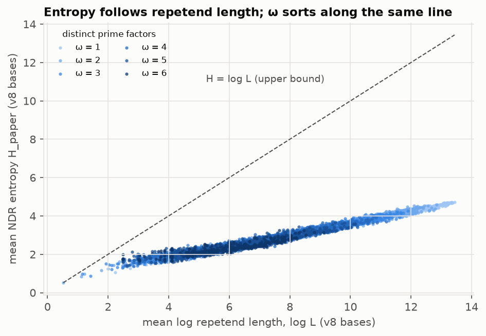

# Sieve Echo v11 — claim verdicts (scale-s0-step9)

- **Run:** `scale-s0-step9`, config `empirical-scripts/11.0/config/scale.json` (sha256 `d700b4e415`), seed 0.
- **Code:** root `74fd86010e` (dirty), libs/evolvo `d2111859f0`, v11 sources sha256 `7046ea7646`.
- **Definitions:** `None`; primary base set `None`; entropies .
- **Data:** 41074 integers, 783040 coprime (n, b) pairs; split {'train': 28752, 'val': 6160, 'test': 6162} (split sha256 `9789b5b2e5`).
- **Inference:** None bootstrap resamples (95% percentile CIs over test rows), None permutations; effect threshold None (ΔR², η² excess, r²).

Paper statistics are re-computed the way the v8.2 code computed them (in-sample, `H_v8`, n ∈ [2, 9999]); corrected tests fit on the train split and report on the test split.

## Figures

*Test-split integers: mean H_paper against mean log L, coloured by ω. Points with more prime factors sit lower because their repetends are shorter, not off the H–log L curve (claims C1, C9).*

## Verdicts

No `claims` stage in this run; see the sections below.

## Step 9a — Small-prime membership and the residue structure

I_q,b = [ord_n(q) | ord_n(b)] for q ∈ [2, 3, 5, 7, 11, 13] (= q ∈ ⟨b⟩ when (ℤ/nℤ)* is cyclic). Share of pairs with I = 1: q=2: 0.495, q=3: 0.504, q=5: 0.512, q=7: 0.522, q=11: 0.546, q=13: 0.527.

| entropy | test pairs | test R² (log L, log b, log n, Midy, extra zeros) | + membership | ΔR² [95% CI] | residual variance explained | coefficients by q |
| --- | --- | --- | --- | --- | --- | --- |
| H_nodc | 77709 | 0.99765 | 0.99796 | +0.00031 [+0.000, +0.000] | 0.132 | 2: -0.109, 3: -0.023, 5: +0.010, 7: +0.012, 11: +0.029, 13: +0.028 |
| H_paper | 77709 | 0.91395 | 0.92367 | +0.00972 [+0.009, +0.010] | 0.113 | 2: -0.034, 3: +0.006, 5: +0.014, 7: +0.002, 11: +0.031, 13: +0.006 |

**C7 residues** (C7 controls + Midy flag + extra-zero share/indicator of each primary-set base; then + [ord(q) | ord(b)] for each small prime q and primary-set base b; 72 membership columns). Excess η² over the permutation null (p):

| entropy | modulus | C7 + Midy + zeros | + membership |
| --- | --- | --- | --- |
| H_paper | 6 | +0.0023 (p 0.004) | +0.0011 (p 0.040) |
| H_paper | 12 | +0.0217 (p 0.002) | +0.0109 (p 0.002) |
| H_paper | 30 | +0.0142 (p 0.002) | +0.0123 (p 0.002) |
| H_paper | 210 | +0.0319 (p 0.002) | +0.0227 (p 0.002) |
| H_nodc | 6 | +0.0018 (p 0.008) | +0.0006 (p 0.088) |
| H_nodc | 12 | +0.0325 (p 0.002) | +0.0201 (p 0.002) |
| H_nodc | 30 | +0.0063 (p 0.002) | +0.0056 (p 0.002) |
| H_nodc | 210 | +0.0152 (p 0.002) | +0.0105 (p 0.004) |

Full numbers: `euler.json` in this run directory.
