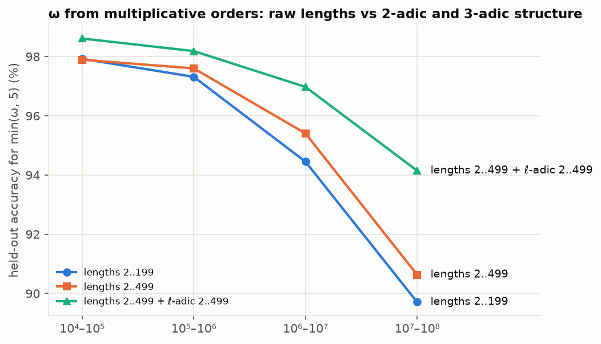

# Sieve Echo v11 — claim verdicts (step11-s0)

- **Run:** `step11-s0`, config `empirical-scripts/11.0/config/orders.json` (sha256 `fd6bd07dd2`), seed 0.
- **Code:** root `a5fe95302f` (dirty), libs/evolvo `d2111859f0`, v11 sources sha256 `4bde378b86`.
- **Definitions:** `None`; primary base set `None`; entropies .
- **Data:** None integers, None coprime (n, b) pairs; split None (split sha256 `unknown`).
- **Inference:** None bootstrap resamples (95% percentile CIs over test rows), None permutations; effect threshold None (ΔR², η² excess, r²).

Paper statistics are re-computed the way the v8.2 code computed them (in-sample, `H_v8`, n ∈ [2, 9999]); corrected tests fit on the train split and report on the test split.

## Figures

*Gradient-boosting accuracy per decade on the same integers: raw per-base log lengths with lcm arithmetic and Midy flags (bases 2…199), the histograms of the 2-adic and 3-adic valuations of the orders (bases 2…499) with log n and v₂(n), and both (step 10).*

## Verdicts

No `claims` stage in this run; see the sections below.

## Step 10 — The 2-rank of (ℤ/nℤ)*

58808 integers (the `orders` sample: 3000 per class min(ω, 5) per decade); orders in bases 2..499. ω(n) = rank₂ − δ(v₂(n)) + [n even], and P(v₂(ord b) ≤ 1)/P(v₂(ord b) = 0) = 2^rank₂ for uniform b.

**10b/11b — estimators**: ratio round(log₂(#{v₂ ≤ 1}/#{v₂ = 0})) and, when present, the maximum-likelihood rank from the whole v₂ profile; accuracy per decade (cells: ratio / MLE, share of n with no odd-order base):

| bases | count | 10000–99999 | 100000–999999 | 1000000–9999999 | 10000000–99999999 |
| --- | --- | --- | --- | --- | --- |
| 19 bases | 19 | 0.409 / 0.461 (0.41) | 0.371 / 0.413 (0.42) | 0.367 / 0.407 (0.41) | 0.357 / 0.396 (0.39) |
| 2..99 | 98 | 0.586 / 0.621 (0.22) | 0.522 / 0.560 (0.24) | 0.509 / 0.545 (0.23) | 0.495 / 0.527 (0.23) |
| 2..199 | 198 | 0.689 / 0.715 (0.16) | 0.623 / 0.652 (0.18) | 0.593 / 0.623 (0.17) | 0.579 / 0.610 (0.18) |
| 2..499 | 498 | 0.817 / 0.834 (0.09) | 0.755 / 0.775 (0.11) | 0.712 / 0.733 (0.11) | 0.694 / 0.720 (0.11) |
| primes < 500 | 95 | 0.680 / 0.689 (0.21) | 0.653 / 0.672 (0.25) | 0.631 / 0.651 (0.26) | 0.618 / 0.642 (0.28) |

**10c — what carries ω** (GBM accuracy, 3 seeds; ℓ-adic profiles = log n, v₂(n), histograms of v₂ and v₃ of the orders, ratio estimates):

| model | 10000–99999 | 100000–999999 | 1000000–9999999 | 10000000–99999999 |
| --- | --- | --- | --- | --- |
| lengths 2..199 | 0.9792 | 0.9732 | 0.9445 | 0.8971 |
| lengths 2..199 + ℓ-adic 2..199 | 0.9869 | 0.9817 | 0.9639 | 0.9287 |
| ℓ-adic 2..499 | 0.9673 | 0.9565 | 0.9253 | 0.8959 |
| lengths 2..499 | 0.9789 | 0.9760 | 0.9541 | 0.9063 |
| lengths 2..499 + ℓ-adic 2..499 | 0.9861 | 0.9819 | 0.9698 | 0.9415 |

Gains over the length model (points, 95% CI):

- 10000–99999: lengths 2..199 + ℓ-adic 2..199: +0.77 [+0.383, +1.166]; ℓ-adic 2..499: -1.20 [-1.908, -0.479]; lengths 2..499: -0.03 [-0.376, +0.351]; lengths 2..499 + ℓ-adic 2..499: +0.69 [+0.160, +1.206]
- 100000–999999: lengths 2..199 + ℓ-adic 2..199: +0.85 [+0.382, +1.342]; ℓ-adic 2..499: -1.66 [-2.623, -0.749]; lengths 2..499: +0.28 [-0.188, +0.734]; lengths 2..499 + ℓ-adic 2..499: +0.87 [+0.270, +1.469]
- 1000000–9999999: lengths 2..199 + ℓ-adic 2..199: +1.94 [+1.167, +2.694]; ℓ-adic 2..499: -1.92 [-3.010, -0.712]; lengths 2..499: +0.95 [+0.279, +1.615]; lengths 2..499 + ℓ-adic 2..499: +2.52 [+1.695, +3.354]
- 10000000–99999999: lengths 2..199 + ℓ-adic 2..199: +3.16 [+2.234, +3.992]; ℓ-adic 2..499: -0.12 [-1.445, +1.423]; lengths 2..499: +0.92 [+0.238, +1.653]; lengths 2..499 + ℓ-adic 2..499: +4.44 [+3.477, +5.459]

Comparisons at a fixed base set (points, 95% CI):

- 10000–99999: lengths 2..199 + ℓ-adic 2..199 vs lengths 2..199: +0.77 [+0.391, +1.133]; lengths 2..499 + ℓ-adic 2..499 vs lengths 2..499: +0.72 [+0.192, +1.213]; lengths 2..499 vs lengths 2..199: -0.03 [-0.383, +0.367]
- 100000–999999: lengths 2..199 + ℓ-adic 2..199 vs lengths 2..199: +0.85 [+0.330, +1.394]; lengths 2..499 + ℓ-adic 2..499 vs lengths 2..499: +0.58 [+0.127, +1.132]; lengths 2..499 vs lengths 2..199: +0.28 [-0.135, +0.719]
- 1000000–9999999: lengths 2..199 + ℓ-adic 2..199 vs lengths 2..199: +1.94 [+1.145, +2.671]; lengths 2..499 + ℓ-adic 2..499 vs lengths 2..499: +1.57 [+0.880, +2.253]; lengths 2..499 vs lengths 2..199: +0.95 [+0.352, +1.629]
- 10000000–99999999: lengths 2..199 + ℓ-adic 2..199 vs lengths 2..199: +3.16 [+2.211, +3.962]; lengths 2..499 + ℓ-adic 2..499 vs lengths 2..499: +3.52 [+2.584, +4.379]; lengths 2..499 vs lengths 2..199: +0.92 [+0.223, +1.653]

Full numbers: `tworank.json` in this run directory.
