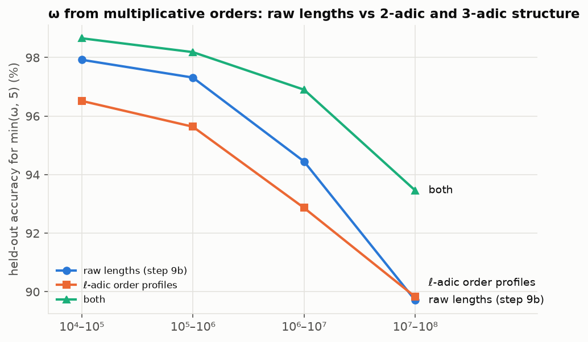

# Sieve Echo v11 — claim verdicts (tworank-s0)

- **Run:** `tworank-s0`, config `empirical-scripts/11.0/config/orders.json` (sha256 `fa3a6d4621`), seed 0.
- **Code:** root `ab81e95007` (dirty), libs/evolvo `d2111859f0`, v11 sources sha256 `2b770f551c`.
- **Definitions:** `None`; primary base set `None`; entropies .
- **Data:** None integers, None coprime (n, b) pairs; split None (split sha256 `unknown`).
- **Inference:** None bootstrap resamples (95% percentile CIs over test rows), None permutations; effect threshold None (ΔR², η² excess, r²).

Paper statistics are re-computed the way the v8.2 code computed them (in-sample, `H_v8`, n ∈ [2, 9999]); corrected tests fit on the train split and report on the test split.

## Figures

*Gradient-boosting accuracy per decade on the same integers: raw per-base log lengths with lcm arithmetic and Midy flags (bases 2…199), the histograms of the 2-adic and 3-adic valuations of the orders (bases 2…499) with log n and v₂(n), and both (step 10).*

## Verdicts

No `claims` stage in this run; see the sections below.

## Step 10 — The 2-rank of (ℤ/nℤ)*

58808 integers (the `orders` sample: 3000 per class min(ω, 5) per decade); orders in bases 2..499. ω(n) = rank₂ − δ(v₂(n)) + [n even], and P(v₂(ord b) ≤ 1)/P(v₂(ord b) = 0) = 2^rank₂ for uniform b.

**10b — ratio estimator** round(log₂(#{v₂ ≤ 1}/#{v₂ = 0})), accuracy per decade (share of n with no odd-order base):

| bases | count | 10000–99999 | 100000–999999 | 1000000–9999999 | 10000000–99999999 |
| --- | --- | --- | --- | --- | --- |
| 19 bases | 19 | 0.409 (0.41) | 0.371 (0.42) | 0.367 (0.41) | 0.357 (0.39) |
| 2..99 | 98 | 0.586 (0.22) | 0.522 (0.24) | 0.509 (0.23) | 0.495 (0.23) |
| 2..199 | 198 | 0.689 (0.16) | 0.623 (0.18) | 0.593 (0.17) | 0.579 (0.18) |
| 2..499 | 498 | 0.817 (0.09) | 0.755 (0.11) | 0.712 (0.11) | 0.694 (0.11) |
| primes < 500 | 95 | 0.680 (0.21) | 0.653 (0.25) | 0.631 (0.26) | 0.618 (0.28) |

**10c — what carries ω** (GBM accuracy, 3 seeds; ℓ-adic profiles = log n, v₂(n), histograms of v₂ and v₃ of the orders, ratio estimates):

| model | 10000–99999 | 100000–999999 | 1000000–9999999 | 10000000–99999999 |
| --- | --- | --- | --- | --- |
| lengths 2..199 (step 9b) | 0.9792 | 0.9732 | 0.9445 | 0.8971 |
| ℓ-adic profiles 2..199 | 0.9596 | 0.9363 | 0.8827 | 0.8475 |
| ℓ-adic profiles 2..499 | 0.9652 | 0.9564 | 0.9287 | 0.8983 |
| lengths 2..199 + ℓ-adic 2..499 | 0.9866 | 0.9819 | 0.9690 | 0.9346 |

Gains over the length model (points, 95% CI):

- 10000–99999: ℓ-adic profiles 2..199: -1.96 [-2.738, -1.229]; ℓ-adic profiles 2..499: -1.40 [-2.124, -0.686]; lengths 2..199 + ℓ-adic 2..499: +0.73 [+0.255, +1.254]
- 100000–999999: ℓ-adic profiles 2..199: -3.69 [-4.729, -2.742]; ℓ-adic profiles 2..499: -1.68 [-2.616, -0.815]; lengths 2..199 + ℓ-adic 2..499: +0.87 [+0.277, +1.477]
- 1000000–9999999: ℓ-adic profiles 2..199: -6.18 [-7.567, -5.034]; ℓ-adic profiles 2..499: -1.59 [-2.715, -0.491]; lengths 2..199 + ℓ-adic 2..499: +2.45 [+1.695, +3.149]
- 10000000–99999999: ℓ-adic profiles 2..199: -4.96 [-6.622, -3.468]; ℓ-adic profiles 2..499: +0.12 [-1.147, +1.616]; lengths 2..199 + ℓ-adic 2..499: +3.75 [+2.755, +4.617]

Full numbers: `tworank.json` in this run directory.
