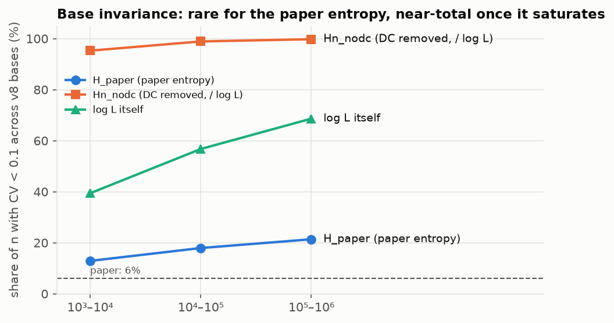
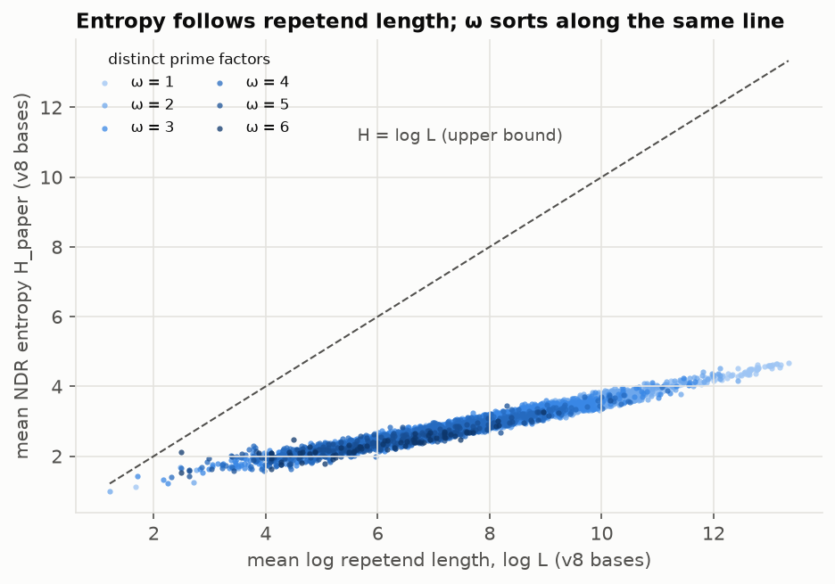
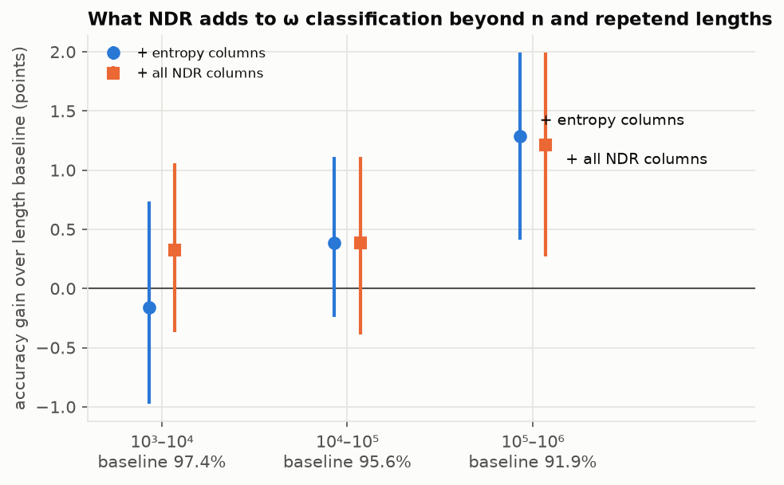
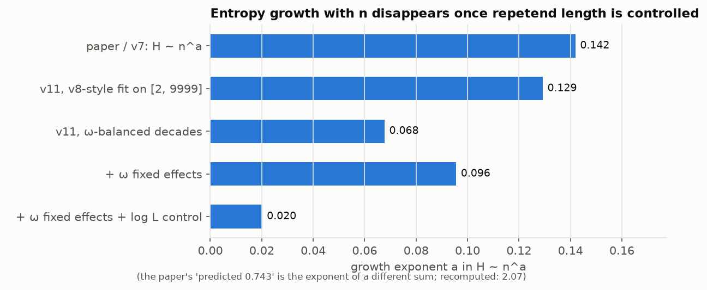

# The Sieve Echo Conjecture, Revisited: What Repetend Entropy Does and Does Not Encode

**Revision 9 — draft for the author's review (November 2026).** Supersedes the empirical claims of [`studies/8/sieve-echo-conjecture-8.md`](../8/sieve-echo-conjecture-8.md). Every number below comes from the v11 program in [`empirical-scripts/11.0/`](../../empirical-scripts/11.0) and names the run that produced it (seed 0 throughout; run summaries, manifests and code hashes are committed under `empirical-scripts/11.0/results/<run-id>/`).

## Abstract

We re-examine the Sieve Echo Conjecture — that the factorization complexity of an integer *n*, chiefly ω(n), is encoded in the spectral entropy of the normalized digits (NDR) of the repetend of 1/n across bases. With one canonical, tested definition, held-out evaluation, controls for repetend length *L* = ord_n(b) and log *n*, and permutation nulls, we find:

1. Every stored statistic of the v8 paper is reproduced exactly from its own code path (law fit α = −0.4681, β = 1.9174, R² = 0.2345; 6% base invariance; ζ and PNT correlations; residue-class variances) — and each is explained by repetend length, by the size of *n*, by construction, or by a small sample.
2. NDR entropy is, to first order, a function of repetend length: log *L* and log *n* explain 95.9% of its held-out variance; adding log ω adds 0.04% (run `full-s0-step4`). Primes have the *highest* entropy, not the lowest.
3. The factorization information that is present lives in the repetend **lengths**. A gradient-boosting classifier on *n* and the per-base lengths (with their lcm arithmetic) predicts ω classes with 98.2% held-out accuracy; all NDR features together add 0.6 points (`full-s0-step4`). An evolved three-instruction formula recognizes primes with 99.99% held-out accuracy from "lcm of the repetend lengths divides *n* − 1" — Fermat's little theorem in repetend form.
4. The small residual NDR signal grows with *n*: entropy features add +1.3 accuracy points at 10⁵–10⁶ (95% CI [+0.4, +2.0]) but none detectable at 10⁴–10⁵ (`scale-s0`).

The "echo" of the sieve is real, but it is the multiplicative order, not the digit entropy.

---

## 1. Definitions

For *n* ≥ 2 and a base *b* with gcd(*n*, *b*) = 1, the expansion of 1/*n* in base *b* is purely periodic with period *L* = ord_n(b). With remainders *r*₀ = 1, *r*ₖ₊₁ = *b·r*ₖ mod *n*, the digits are *d*ₖ = ⌊*b·r*ₖ / *n*⌋.

**Definition 1.1 (NDR).** Θ_{n,b} = (*d*₀/*b*, …, *d*_{L−1}/*b*).

**Definition 1.2 (NDR entropy).** H_NDR(n, b) = −Σₖ pₖ log pₖ with pₖ = |Θ̂(k)|² / Σⱼ |Θ̂(j)|² over all *L* DFT bins (natural log). We call this `H_paper`. We also use `H_nodc` (bins 1…*L*−1, i.e. the mean-removed sequence) and the normalized forms H/log *L*.

All definitions are implemented once in [`ndr.py`](../../empirical-scripts/11.0/ndr.py) (version tag `ndr-v11.1`), with *L* computed exactly from the Carmichael function λ(n) and the digits generated in exactly *L* steps. Rescaling the digits (d/b vs d/(b−1)) leaves every entropy unchanged (unit-tested).

**Two facts used throughout.**

* *H_NDR ≤ log L* — the entropy of a distribution on *L* bins.
* **Theorem 1.3 (length bound).** For odd *n* with ω = ω(n) distinct prime factors and any base *b* coprime to *n*, ord_n(b) divides λ(n), and λ(n) ≤ φ(n) / 2^{ω−1} < n / 2^{ω−1}.

  *Proof.* ord_n(b) | λ(n) by definition of the Carmichael function. For odd *n* = ∏ pᵢ^{kᵢ}, λ(n) = lcm(φ(pᵢ^{kᵢ})) and every φ(pᵢ^{kᵢ}) is even; for even integers lcm(*a*, *c*) = *ac*/gcd(*a*, *c*) ≤ *ac*/2, so by induction the lcm of ω even numbers is at most their product over 2^{ω−1}. ∎

  Hence log L ≤ log n − (ω − 1) log 2 for odd *n*: more distinct prime factors force shorter repetends, and shorter repetends force lower entropy. This is the mechanism behind the negative slope of the "Sieve Echo Law"; it needs no property of the digits.

## 2. Data and method

| run | config | content |
| --- | --- | --- |
| `quick-s0-step4` | `config/quick.json` | all n ∈ [2, 9 999] + 100 integers per ω from [10⁴, 10⁵]; 10 523 integers |
| `full-s0-step4` | `config/full.json` | all n ∈ [2, 150 000] + 2 000 per ω from (1.5·10⁵, 10⁶]; 162 007 integers, 2 340 678 (n, b) pairs |
| `scale-s0` | `config/scale.json` | all n ∈ [2, 9 999] + 3 000 per ω in [10⁴, 10⁵) and in [10⁵, 10⁶]; 41 074 integers |

Base sets: the v8 paper's 13 bases {2–7, 9–11, 13–16} (`v8`), v10's 16 bases, the primes ≤ 31, and a wide set 2…99 on a sub-sample. Integers are split once, by *n*, stratified by ω, 70/15/15 (train/validation/test). Every fitted quantity is fitted on train and reported on test; every claim is also tested conditional on log *L* and log *n*, with 95% bootstrap confidence intervals and permutation nulls. Factorization labels (ω, Ω, τ, φ, λ, μ, primality) are never inputs of a predictor of ω.

## 3. Reproduction of the v8 statistics

Run `full-s0-step4` (the v8 statistics are recomputed on n ∈ [2, 9 999] with v8's own definitions):

| v8 statistic | paper | v11 re-computation | what it actually measures |
| --- | --- | --- | --- |
| Law fit (§2.2) | α = −0.468, β = 1.917, R² = 0.234 | −0.4681, 1.9174, 0.2345 | an OLS on **log(ω + 1)**, not the log ω printed in the paper (with log ω: α = −0.305, R² = 0.229) |
| Base invariance (§2.4) | 6% | 6% on v8's first 100 integers; 9.1% on all n ∈ [2, 9 999] (`quick-s0-step4`) | a 100-integer sample |
| ζ correlations (§4.1) | −0.441, −0.337, −0.289 (s = 2, 3, 4) | identical on the same 100 integers; −0.114, −0.083, −0.070 on all n ∈ [2, 9 999] | a 100-integer sample of a size effect |
| PNT (§4.2) | r(H·log n, H) = 0.946 | 0.946 | H appears on both sides (0.831 with H permuted across *n*) |
| Residue classes (§4.3) | variance of class means 0.0153–0.0205 | identical | composition of bases coprime to *n* (§4, Observation 4.7) |
| Prime-power r (§2.3) | −0.843 | — | corr(ω, is_prime_power) from a v7.0 log: two factorization labels, no entropy |
| Three-feature accuracy (§3.1) | 98.8% | — | training-set accuracy of a v7.0 model that used `is_prime_power` |

The paper's v8 numbers were produced by `8.0/sieve-echo-tests-2.py` (v8.2), not by `-1.py`; its entropy is |FFT|² over the first ⌊L/2⌋ bins with the DC bin kept. v11 reproduces that script's stored per-base entropies to 10⁻⁹ (unit test `ReproduceV8Tests`).

## 4. Corrected results, claim by claim

The "Theorems" of the v8 paper are empirical fits; here they are **Observations**, each with the run that measured it. Unless noted: run `full-s0-step4`, entropy `H_paper` averaged over the v8 bases, test split (24 302 integers).

**Observation 4.1 (the law is a length law; C1).** Held-out R² of H: log ω alone 0.364; log *L* + log *n* 0.959; log ω + log *L* + log *n* 0.959. The gain from log ω is ΔR² = 0.0004 (95% CI [0.000, 0.001]); partial r(H, log ω | log *L*, log *n*) = −0.10. With the DC bin removed the baseline reaches 0.991 and log ω adds 0.002 (`quick-s0-step4`: 0.004).

**Observation 4.2 (direction; C2).** Primes have the highest entropy: mean H of primes minus composites = +0.706 (CI [0.686, 0.724]); Spearman(H, ω) = −0.61. The v8 paper's §1.3 ("primes … pure, low-entropy patterns") and §7.1 item 2 ("higher complexity correlates with higher entropy") are contradicted by the data and by Theorem 1.3; only the sign α < 0 is right.

**Observation 4.3 (no prime-power dichotomy; C3).** r(H, prime power) = +0.389 on test, and −0.058 (CI [−0.068, −0.047]) given log *L* and log *n*: prime powers are not special once repetend length is known.

**Observation 4.4 (base invariance is rare and does not emerge; C4).** For `H_paper` the share of integers with CV < 0.1 across the v8 bases is 13% / 18% / 21% in the ω-balanced decades 10³–10⁴ / 10⁴–10⁵ / 10⁵–10⁶ (`scale-s0`), far from universal. The DC-free normalized entropy becomes invariant (95% → 99% → 100%), but only because it saturates near its maximum for long, noise-like repetends; log *L* itself crosses the same threshold for 39% → 57% → 69%.



**Observation 4.5 (no ζ connection; C5).** After a cubic in log *n*, the partial correlations of H with *n*^{−s} are −0.023, −0.019, −0.017 (s = 2, 3, 4); log *n* alone explains 21% of the variance of H.

**Observation 4.6 (no PNT connection; C6).** corr(H·log *n*, H) = 0.946, against 0.831 (CI [0.826, 0.836]) when H is randomly permuted across integers; the excess is H's growth with *n*. The prime-counting errors |n/log n − π(n)| and |li(n) − π(n)| have partial correlations −0.03 and −0.02 with H given log *n*.

**Observation 4.7 (small residue structure; C7).** Residue classes of *n* modulo 6, 12, 30, 210 explain 22–32% of the variance of H raw, because they fix which bases are coprime to *n* and how long the per-base repetends are. After controlling per-base log *L*, coprimality, log *n* and ω, a small excess remains (η² above the permutation null: 0.000, 0.033, 0.014, 0.032; p ≤ 0.002 except mod 6) — consistent with information about *n* mod 4 (mod 12 exceeds mod 6) and mod 7 (mod 210 exceeds mod 30) that is not ω.

**Observation 4.8 (no special constants; C8).** No 95% interval of α or β contains the "theoretical" −1.599 or 4.933 under any definition (e.g. canonical H with log(ω+1): α = −1.155, CI [−1.164, −1.147]). A random value near α matches some sum or difference of v8's 20-constant library within 0.01 with probability 0.87, so the "tribonacci − ln 10" match carries no evidence.

**Observation 4.9 (what NDR adds beyond repetend length; C9).** Held-out classification of min(ω, 5):


| model (`full-s0-step4`) | test accuracy |
| --- | --- |
| majority class | 37.2% |
| logistic regression on log *n*, mean log *L* | 59.7% |
| gradient boosting on log *n* + per-base log *L* + lcm arithmetic | 98.2% |
| … + entropy columns | 98.6% (Δ +0.4, CI [+0.2, +0.5]) |
| … + all NDR columns | 98.9% (Δ +0.6, CI [+0.5, +0.8]) |
| shuffled-label null | 37.2% |

The lcm arithmetic matters: without lcm(*L_b*) and its relation to *n* − 1 the same classifier on the raw per-base lengths reaches 94.9%, against 97.8% with it (`quick-s0-step6`) — a gap that NDR features would otherwise appear to fill. NDR does carry a little information that a tree model cannot read off the lengths, but it is about one accuracy point.



## 5. Evolutionary search with Evolvo

Formulas were evolved with the Evolvo GFSL language (submodule `libs/evolvo`) on 12 allowed inputs (log *n*, v8 entropy and length aggregates, NDR mean, and the length arithmetic), fitness 1/(1 + NMSE) − 0.002 × size on a growing train sample (5 000 → 100 000 integers), selected on validation and scored once on test (`full-s0-step4`, population 200, 60 generations, 5 seeds × 4 guides).

**Observation 5.1 (primality from repetend lengths).** Every guide finds, in under a thousand evaluations on average, a formula of at most three instructions on the input "lcm(L_b) divides *n* − 1" with test accuracy 99.99% (NMSE 0.0014). This is Fermat's little theorem: for prime *p*, ord_p(b) | p − 1 for every base, so the lcm of the lengths divides *p* − 1; a composite passes only if it is a Fermat pseudoprime to all 19 bases at once.

**Observation 5.2 (ω formulas are weak).** The best evolved ω formula, ((z(log n − log lcm) · |z(lcm | n−1)|^{1/4}) + e) on standardized inputs, reaches test NMSE 0.276 and 65.5% class accuracy — essentially log(n/λ(n)) — against 89.6% for gradient boosting on the same inputs.

**Observation 5.3 (search tooling).** A growing evaluation sample (S1) did not hurt (ω test NMSE 0.309 vs 0.315 at a fixed 5 000 integers; Mann–Whitney p = 0.18). A PyTorch policy-gradient mutation guide (S2) matched but did not beat plain evolution (ω 0.310 vs 0.309); warm-starting it from saved weights reached the is_prime target in fewer evaluations (504 vs 620) but not a lower error. No guide difference is significant over 5 seeds.


**Observation 5.4 (neural architecture search).** GFSL-NN architecture search reaches 94.8% on the feature table and 94.8% on a set of per-base tokens; the best set architecture leaves the token branch unused and predicts from log *n* and the length arithmetic.

## 6. Scale and growth

**Observation 6.1 (stability to 10⁶).** On ω-balanced samples per decade (`scale-s0`), the verdicts of C1–C4 are the same at 10⁴–10⁵ and 10⁵–10⁶. C9 drifts: the length baseline loses accuracy with *n* (97.4% → 95.6% → 91.9%) as 19 bases pin down λ(n) less completely, and entropy features then add +1.3 points (CI [+0.4, +2.0]) at 10⁵–10⁶.



**Observation 6.2 (growth exponents).** A v8-style fit on n ∈ [2, 9 999] gives H ≈ 0.460 · n^{0.129} (v7 reported 0.431 · n^{0.142}). On ω-balanced decades the exponent is 0.068 (0.096 with ω fixed effects) and falls to **0.020 once log L is controlled**: the growth of entropy with *n* is the growth of repetend length. The "predicted exponent 0.743" of the earlier papers belongs to a different quantity, T(x) = Σ_{p≤x} Σ_{n≤x, gcd(n,p)=1} log ord_n(p); computed for x = 100 … 3 200 its exponent is 2.07, as its x·π(x) terms imply. The two exponents are not comparable.



## 7. What survives

* **The order survives, the entropy does not.** Factorization structure reaches the repetend of 1/*n* through its length ord_n(b), which divides λ(n) and shrinks with each additional prime factor (Theorem 1.3). Digit entropy inherits that structure because H ≤ log L. Once length is known, entropy adds at most about one accuracy point for ω.
* **Reformulated conjecture (open).** *The NDR spectra of 1/n carry information about ω(n) beyond the multiset {ord_n(b)} and n, and that information grows with n.* Observation 6.1 is weak evidence for it at 10⁵–10⁶; it should be tested against a stronger length baseline (more bases, or λ(n) estimated from the lengths) before any mechanism is proposed.
* **Not supported:** the law's constants (golden ratio, 5 − 1/15), base invariance as a universal property, links to ζ(s) or the PNT, the prime-power dichotomy, and three-feature sufficiency.

## 8. Open questions

1. Which per-base NDR statistic carries the residual signal at 10⁵–10⁶, and does it survive when the baseline includes lengths in all bases 2…99?
2. Is the C7 residue structure (n mod 4, mod 7) explained by the quadratic characters of the bases, i.e. by whether −1 lies in ⟨b⟩ mod *n*?
3. Can an evolved formula recover λ(n) or *n*/λ(n) from the lengths exactly — and how much of ω does *n*/λ(n) determine?

## 9. Reproducing these results

```bash
git submodule update --init --recursive
/opt/homebrew/bin/python3.15 -m venv .venv
.venv/bin/pip install --only-binary :all: -r empirical-scripts/11.0/requirements.txt
.venv/bin/python -m unittest discover -s empirical-scripts/11.0/tests
.venv/bin/python empirical-scripts/11.0/sieve_echo_v11.py --config empirical-scripts/11.0/config/full.json --run-id full-s0-repro
.venv/bin/python empirical-scripts/11.0/sieve_echo_v11.py --config empirical-scripts/11.0/config/scale.json --run-id scale-s0-repro --stages data,claims,scale,report
```

Each run writes `manifest.json` (code and submodule SHAs, v11 source hash, environment, config, seed, NDR version), the claim, search and scale results, and `report.md` with the figures. The full run takes about 53 minutes and the scale run about 22 minutes on an 8-core machine.
