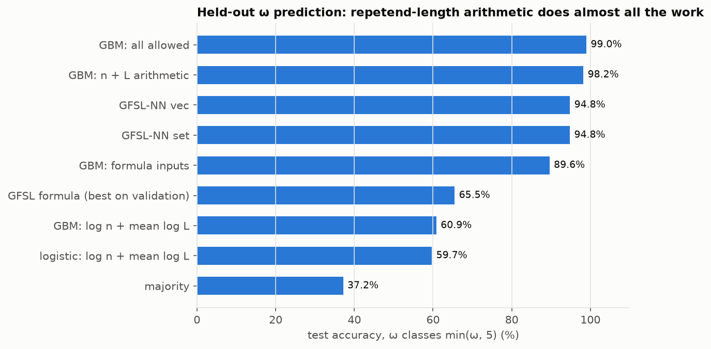
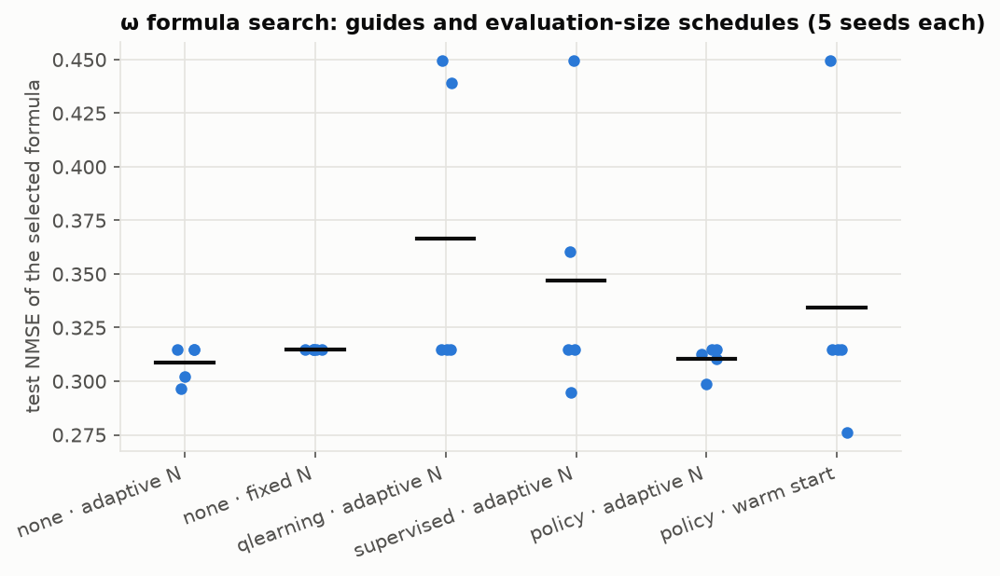
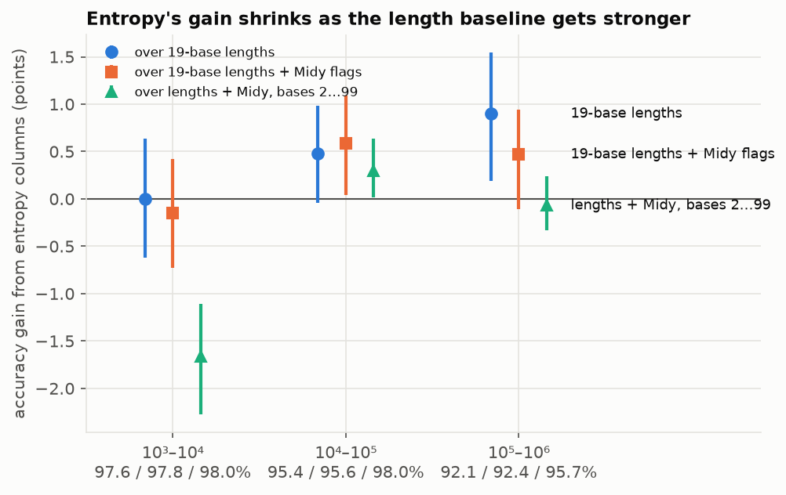
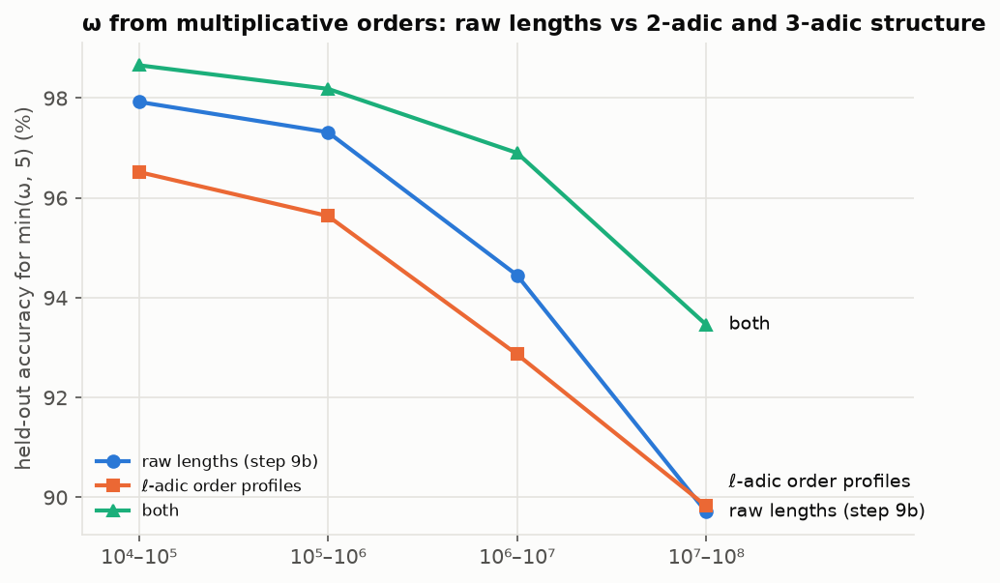

# The Sieve Echo Conjecture, Revisited: What Repetend Entropy Does and Does Not Encode

**Revision 9 — draft for the author's review (November 2026).** Supersedes the empirical claims of [`studies/8/sieve-echo-conjecture-8.md`](../8/sieve-echo-conjecture-8.md). Every number below comes from the v11 program in [`empirical-scripts/11.0/`](../../empirical-scripts/11.0) and names the run that produced it (seed 0 throughout; run summaries, manifests and code hashes are committed under `empirical-scripts/11.0/results/<run-id>/`).

## Abstract

We re-examine the Sieve Echo Conjecture — that the factorization complexity of an integer *n*, chiefly ω(n), is encoded in the spectral entropy of the normalized digits (NDR) of the repetend of 1/n across bases. With one canonical, tested definition, held-out evaluation, controls for repetend length *L* = ord_n(b) and log *n*, and permutation nulls, we find:

1. Every stored statistic of the v8 paper is reproduced exactly from its own code path (law fit α = −0.4681, β = 1.9174, R² = 0.2345; 6% base invariance; ζ and PNT correlations; residue-class variances) — and each is explained by repetend length, by the size of *n*, by construction, or by a small sample.
2. NDR entropy is, to first order, a function of repetend length: log *L* and log *n* explain 95.9% of its held-out variance; adding log ω adds 0.04% (run `full-s0-step4`). Primes have the *highest* entropy, not the lowest.
3. The factorization information that is present lives in the repetend **lengths**. A gradient-boosting classifier on *n* and the per-base lengths (with their lcm arithmetic) predicts ω classes with 98.2% held-out accuracy; all NDR features together add 0.6 points (`full-s0-step4`). An evolved three-instruction formula recognizes primes with 99.99% held-out accuracy from "lcm of the repetend lengths divides *n* − 1" — Fermat's little theorem in repetend form.
4. A small residual NDR signal seemed to grow with *n* (+1.3 accuracy points at 10⁵–10⁶ over a 19-base length baseline, `scale-s0`). It does not survive a stronger baseline: with the orders in every base 2…99 and one symmetry bit per base, entropy adds −0.07 points (95% CI [−0.33, +0.24]) at 10⁵–10⁶ (`scale-s0-step7`).
5. The one digit property that carries information beyond the lengths is **Midy's symmetry**: when −1 ∈ ⟨b⟩ mod *n* the two halves of the repetend are digit complements, every even Fourier bin vanishes, and the DC-free entropy drops by exactly log 2 on average (fitted −0.694). The symmetry depends on the 2-adic valuations of the orders modulo each prime power of *n* (Proposition 1.4), so it thins out as ω grows (61.5% of pairs for ω = 1, 1.0% for ω = 5); as a feature it adds +0.4 points beyond the 98 lengths.

6. The digit spectrum also has **exact zeros** that mark the factorization: by Proposition 1.5 a whole frequency class vanishes when the Euler factors (1 − χ*(p)) of the relevant characters vanish at primes *p* | *n*. Such zeros occur in 0.09% of prime (*n*, *b*) pairs and 11–30% of composite pairs — yet they add nothing to ω classification once the orders in 98 bases are known (−0.05 points, CI [−0.28, +0.18]; `scale-s0-step8`). Spectra taken after SinWhisky's circle-based resampling carry the same information as the plain FFT (`scale-s0-step8e`).

The "echo" of the sieve is real, and it even reaches the digits as Midy's symmetry and as exact spectral zeros — but everything it says about ω is already said by the multiplicative orders.

---

## 1. Definitions

For *n* ≥ 2 and a base *b* with gcd(*n*, *b*) = 1, the expansion of 1/*n* in base *b* is purely periodic with period *L* = ord_n(b). With remainders *r*₀ = 1, *r*ₖ₊₁ = *b·r*ₖ mod *n*, the digits are *d*ₖ = ⌊*b·r*ₖ / *n*⌋.

**Definition 1.1 (NDR).** Θ_{n,b} = (*d*₀/*b*, …, *d*_{L−1}/*b*).

**Definition 1.2 (NDR entropy).** H_NDR(n, b) = −Σₖ pₖ log pₖ with pₖ = |Θ̂(k)|² / Σⱼ |Θ̂(j)|² over all *L* DFT bins (natural log). We call this `H_paper`. We also use `H_nodc` (bins 1…*L*−1, i.e. the mean-removed sequence) and the normalized forms H/log *L*.

All definitions are implemented once in [`ndr.py`](../../empirical-scripts/11.0/ndr.py) (version tag `ndr-v11.1`), with *L* computed exactly from the Carmichael function λ(n) and the digits generated in exactly *L* steps. Rescaling the digits (d/b vs d/(b−1)) leaves every entropy unchanged (unit-tested).

**Two facts used throughout.**

* *H_NDR ≤ log L* — the entropy of a distribution on *L* bins.
* **Theorem 1.3 (length bound).** For odd *n* with ω = ω(n) distinct prime factors and any base *b* coprime to *n*, ord_n(b) divides λ(n), and λ(n) ≤ φ(n) / 2^{ω−1} < n / 2^{ω−1}.

  *Proof.* ord_n(b) | λ(n) by definition of the Carmichael function. For odd *n* = ∏ pᵢ^{kᵢ}, λ(n) = lcm(φ(pᵢ^{kᵢ})) and every φ(pᵢ^{kᵢ}) is even; for even integers lcm(*a*, *c*) = *ac*/gcd(*a*, *c*) ≤ *ac*/2, so by induction the lcm of ω even numbers is at most their product over 2^{ω−1}. ∎

  Hence log L ≤ log n − (ω − 1) log 2 for odd *n*: more distinct prime factors force shorter repetends, and shorter repetends force lower entropy. This is the mechanism behind the negative slope of the "Sieve Echo Law"; it needs no property of the digits.

* **Proposition 1.4 (Midy symmetry; added in step 7).** Let gcd(*n*, *b*) = 1, *L* = ord_n(b), and call (*n*, *b*) a *Midy pair* when −1 ∈ ⟨b⟩ mod *n*. Then:

  (a) (*n*, *b*) is a Midy pair iff *L* is even and *b*^{L/2} ≡ −1 (mod *n*);

  (b) for a Midy pair the two halves of the repetend are digit complements, *d*_{k+L/2} = *b* − 1 − *d*ₖ, and every DFT bin of Θ_{n,b} with even index *j* ≠ 0 vanishes, so `H_nodc` ≤ log(*L*/2);

  (c) for odd *n* = ∏ pᵢ^{kᵢ}, (*n*, *b*) is a Midy pair iff the orders of *b* modulo the pᵢ^{kᵢ} all have the same 2-adic valuation, and that valuation is ≥ 1.

  *Proof.* (a) If *b*^k ≡ −1 with 0 ≤ k < L then *b*^{2k} ≡ 1, so *L* | 2*k* < 2*L*, hence 2*k* = *L*. (b) The remainders are *r*ₖ ≡ *b*^k, so *r*_{k+L/2} = *n* − *r*ₖ and *d*_{k+L/2} = ⌊*b*(*n* − *r*ₖ)/*n*⌋ = *b* − 1 − ⌊*b·r*ₖ/*n*⌋, because *b·r*ₖ/*n* is not an integer. Then x_{k+L/2} = c − x_k with c = (*b* − 1)/*b*, and for even *j* = 2*m* ≠ 0 the DFT is X_j = c·Σ_{k<L/2} e^{−2πi·mk/(L/2)} = 0. (c) By the CRT, *b*^{L/2} ≡ −1 mod *n* iff it holds modulo every pᵢ^{kᵢ}. Each (ℤ/pᵢ^{kᵢ})* is cyclic, so with *L*ᵢ = ord_{pᵢ^{kᵢ}}(b) we have *b*^m ≡ −1 iff *L*ᵢ ∤ m and *L*ᵢ | 2*m*, i.e. v₂(m) = v₂(*L*ᵢ) − 1 and the odd part of *L*ᵢ divides *m*. With *m* = *L*/2 = lcm(*L*ᵢ)/2 the odd-part condition always holds, and v₂(*L*/2) = maxⱼ v₂(*L*ⱼ) − 1, which equals v₂(*L*ᵢ) − 1 for every *i* iff all v₂(*L*ᵢ) are equal (and ≥ 1, since *L* is even). ∎

  Part (b) is Midy's theorem (1836) in its general form; (c) shows why Midy pairs thin out as ω grows: each extra odd prime factor adds one more 2-adic valuation that must match. The flag is a function of (*n*, *b*) and is visible in the digits, so it is NDR information, not a factorization label; but unlike *L* it is not a function of the length alone. All three parts are unit-tested in [`tests/test_lengths.py`](../../empirical-scripts/11.0/tests/test_lengths.py).

* **Proposition 1.5 (spectral zeros; added in step 8).** With *r*ᵢ = *b*^i mod *n*, *d*ᵢ = (*b·r*ᵢ − *r*_{i+1})/*n* and X_j(x) = Σᵢ xᵢ e^{−2πi·ij/L}:

  (a) X_j(d) = (*b* − e^{2πi·j/L})·X_j(r)/*n*, so the digits, the NDR and the remainders vanish on the same bins;

  (b) with k = L/gcd(j, L) and T_t = Σ_{i ≡ t (mod k)} rᵢ, X_j(r) = Σ_{t<k} T_t ζ_k^{ut} for a primitive k-th root of unity ζ_k^u, so X_j = 0 iff the cyclotomic polynomial Φ_k divides Σ_t T_t x^t — bins vanish in whole classes {j : L/gcd(j, L) = k};

  (c) with G = (ℤ/nℤ)*, H = ⟨b⟩, m = [G : H] and ψ_j(b^i) = e^{−2πi·ij/L}: X_j(r) = (*n*/m) Σ_{χ ∈ Ĝ, χ|_H = ψ_j} B_{1,χ}, where B_{1,χ} = (1/*n*) Σ_{a=1}^{n} χ(a)·a.

  *Proof.* (a) Sum dᵢ e^{−2πi·ij/L} and shift the index of r_{i+1}; *b* − e^{2πi·j/L} ≠ 0 because *b* ≥ 2. (b) e^{−2πi·ij/L} depends on i only modulo k and equals ζ_k^{u·i} with u = j/gcd(j, L) coprime to k; the value of an integer polynomial at a primitive k-th root of unity is 0 iff Φ_k divides it, independently of which root. (c) Orthogonality on G/H: Σ_{χ|_H = ψ} χ(a) = m·ψ(a) for a ∈ H and 0 otherwise. ∎

  Even nontrivial characters have B_{1,χ} = 0 — when every extension of ψ_j is even, the bin vanishes, which is Proposition 1.4(b) again. For χ induced by a primitive χ*, B_{1,χ} = B_{1,χ*} ∏_{p | n} (1 − χ*(p)) (standard; e.g. Washington, *Introduction to Cyclotomic Fields*, ch. 4): an Euler factor vanishes when χ*(p) = 1 for a prime *p* dividing *n*, a relation between the prime factors of *n* that the digit spectrum records as an exact zero. For prime *n* there are no such factors, and zeros need a cancellation among the extensions. Parts (a)–(c) and the Euler-factor formula (for *n* = *p·q*) are checked exactly in [`tests/test_zeros.py`](../../empirical-scripts/11.0/tests/test_zeros.py).

* **Proposition 1.6 (the 2-rank; added in step 10).** Let G = (ℤ/*n*ℤ)* have Sylow-2 subgroup ∏_{i ≤ r} C_{2^{e_i}} (r = rank₂ G, all e_i ≥ 1), and write *n* = 2^a·*m* with *m* odd. Then

  (a) for *b* uniform in G, P(v₂(ord_n b) ≤ k) = 2^{−Σ_i max(e_i − k, 0)} for every k ≥ 0; in particular P(v₂ ≤ 1)/P(v₂ = 0) = 2^r, and G has exactly 2^r elements x with x² = 1;

  (b) r = ω(*m*) + δ(a) with δ(0) = δ(1) = 0, δ(2) = 1, δ(a ≥ 3) = 2, so **ω(*n*) = rank₂ G − δ(a) + [a ≥ 1]**.

  *Proof.* (a) G = S × T with S the Sylow-2 subgroup and |T| odd; the S-component of a uniform *b* is uniform in S, and v₂(ord b) = v₂(ord of the S-component) = max_i of the components' v₂. Component i has v₂ ≤ k with probability 2^{min(e_i, k)}/2^{e_i}, independently. (b) By the CRT G ≅ ∏ (ℤ/p^k)*; for odd *p* the factor is cyclic of even order φ(p^k) and contributes one 2-cyclic component, while (ℤ/2)* is trivial, (ℤ/4)* ≅ C₂ and (ℤ/2^a)* ≅ C₂ × C_{2^{a−2}} for a ≥ 3. ∎

  ω is therefore a property of the group whose elements the bases *b* sample: the orders ord_n(b) — the repetend lengths — determine ω through the 2-adic valuations of their distribution, a quantity a model fed log *L* cannot compute directly. Both parts are checked exactly on every unit of (ℤ/*n*ℤ)* for *n* < 3 000 in [`tests/test_tworank.py`](../../empirical-scripts/11.0/tests/test_tworank.py).

## 2. Data and method

| run | config | content |
| --- | --- | --- |
| `quick-s0-step4` | `config/quick.json` | all n ∈ [2, 9 999] + 100 integers per ω from [10⁴, 10⁵]; 10 523 integers |
| `full-s0-step4` | `config/full.json` | all n ∈ [2, 150 000] + 2 000 per ω from (1.5·10⁵, 10⁶]; 162 007 integers, 2 340 678 (n, b) pairs |
| `scale-s0` | `config/scale.json` | all n ∈ [2, 9 999] + 3 000 per ω in [10⁴, 10⁵) and in [10⁵, 10⁶]; 41 074 integers |
| `scale-s0-step7` | `config/scale.json` | the same integers; adds orders and Midy flags in all bases 2…99 (step 7) |
| `scale-s0-step8` | `config/scale.json` | the same integers; exact zero classes of 517 642 (*n*, *b*) spectra (step 8) |
| `scale-s0-step8e` | `config/scale.json` | 4 851 sampled pairs; spectra after SinWhisky resampling ([`libs/sinwhisky`](../../libs/sinwhisky)) |
| `scale-s0-step9` | `config/scale.json` | the same integers; small-prime membership [ord(q) \| ord(b)] (step 9a) |
| `orders-s0` | `config/orders.json` | 58 808 integers, 3 000 per class min(ω, 5) per decade 10⁴–10⁸; orders only, no digits (step 9b) |
| `tworank-s0` | `config/orders.json` | the same integers; orders in bases 2…499, 2-rank estimator and ℓ-adic order profiles (step 10) |

Base sets: the v8 paper's 13 bases {2–7, 9–11, 13–16} (`v8`), v10's 16 bases, the primes ≤ 31, and a wide set 2…99 on a sub-sample. Integers are split once, by *n*, stratified by ω, 70/15/15 (train/validation/test). Every fitted quantity is fitted on train and reported on test; every claim is also tested conditional on log *L* and log *n*, with 95% bootstrap confidence intervals and permutation nulls. Factorization labels (ω, Ω, τ, φ, λ, μ, primality) are never inputs of a predictor of ω.

## 3. Reproduction of the v8 statistics

Run `full-s0-step4` (the v8 statistics are recomputed on n ∈ [2, 9 999] with v8's own definitions):

| v8 statistic | paper | v11 re-computation | what it actually measures |
| --- | --- | --- | --- |
| Law fit (§2.2) | α = −0.468, β = 1.917, R² = 0.234 | −0.4681, 1.9174, 0.2345 | an OLS on **log(ω + 1)**, not the log ω printed in the paper (with log ω: α = −0.305, R² = 0.229) |
| Base invariance (§2.4) | 6% | 6% on v8's first 100 integers; 9.1% on all n ∈ [2, 9 999] (`quick-s0-step4`) | a 100-integer sample |
| ζ correlations (§4.1) | −0.441, −0.337, −0.289 (s = 2, 3, 4) | identical on the same 100 integers; −0.114, −0.083, −0.070 on all n ∈ [2, 9 999] | a 100-integer sample of a size effect |
| PNT (§4.2) | r(H·log n, H) = 0.946 | 0.946 | H appears on both sides (0.831 with H permuted across *n*) |
| Residue classes (§4.3) | variance of class means 0.0153–0.0205 | identical | composition of bases coprime to *n* (§4, Observation 4.7) |
| Prime-power r (§2.3) | −0.843 | — | corr(ω, is_prime_power) from a v7.0 log: two factorization labels, no entropy |
| Three-feature accuracy (§3.1) | 98.8% | — | training-set accuracy of a v7.0 model that used `is_prime_power` |

The paper's v8 numbers were produced by `8.0/sieve-echo-tests-2.py` (v8.2), not by `-1.py`; its entropy is |FFT|² over the first ⌊L/2⌋ bins with the DC bin kept. v11 reproduces that script's stored per-base entropies to 10⁻⁹ (unit test `ReproduceV8Tests`).

## 4. Corrected results, claim by claim

The "Theorems" of the v8 paper are empirical fits; here they are **Observations**, each with the run that measured it. Unless noted: run `full-s0-step4`, entropy `H_paper` averaged over the v8 bases, test split (24 302 integers).

**Observation 4.1 (the law is a length law; C1).** Held-out R² of H: log ω alone 0.364; log *L* + log *n* 0.959; log ω + log *L* + log *n* 0.959. The gain from log ω is ΔR² = 0.0004 (95% CI [0.000, 0.001]); partial r(H, log ω | log *L*, log *n*) = −0.10. With the DC bin removed the baseline reaches 0.991 and log ω adds 0.002 (`quick-s0-step4`: 0.004).

**Observation 4.2 (direction; C2).** Primes have the highest entropy: mean H of primes minus composites = +0.706 (CI [0.686, 0.724]); Spearman(H, ω) = −0.61. The v8 paper's §1.3 ("primes … pure, low-entropy patterns") and §7.1 item 2 ("higher complexity correlates with higher entropy") are contradicted by the data and by Theorem 1.3; only the sign α < 0 is right.

**Observation 4.3 (no prime-power dichotomy; C3).** r(H, prime power) = +0.389 on test, and −0.058 (CI [−0.068, −0.047]) given log *L* and log *n*: prime powers are not special once repetend length is known.

**Observation 4.4 (base invariance is rare and does not emerge; C4).** For `H_paper` the share of integers with CV < 0.1 across the v8 bases is 13% / 18% / 21% in the ω-balanced decades 10³–10⁴ / 10⁴–10⁵ / 10⁵–10⁶ (`scale-s0`), far from universal. The DC-free normalized entropy becomes invariant (95% → 99% → 100%), but only because it saturates near its maximum for long, noise-like repetends; log *L* itself crosses the same threshold for 39% → 57% → 69%.


**Observation 4.5 (no ζ connection; C5).** After a cubic in log *n*, the partial correlations of H with *n*^{−s} are −0.023, −0.019, −0.017 (s = 2, 3, 4); log *n* alone explains 21% of the variance of H.

**Observation 4.6 (no PNT connection; C6).** corr(H·log *n*, H) = 0.946, against 0.831 (CI [0.826, 0.836]) when H is randomly permuted across integers; the excess is H's growth with *n*. The prime-counting errors |n/log n − π(n)| and |li(n) − π(n)| have partial correlations −0.03 and −0.02 with H given log *n*.

**Observation 4.7 (small residue structure; C7).** Residue classes of *n* modulo 6, 12, 30, 210 explain 22–32% of the variance of H raw, because they fix which bases are coprime to *n* and how long the per-base repetends are. After controlling per-base log *L*, coprimality, log *n* and ω, a small excess remains (η² above the permutation null: 0.000, 0.033, 0.014, 0.032; p ≤ 0.002 except mod 6) — consistent with information about *n* mod 4 (mod 12 exceeds mod 6) and mod 7 (mod 210 exceeds mod 30) that is not ω. Adding the Midy flag of each v8 base (Proposition 1.4) as a further control lowers the mod-12 excess from 0.035 to 0.022 and leaves mod 30 and mod 210 almost unchanged (0.014, 0.031; `scale-s0-step7`): the symmetry explains about a third of the *n* mod 4 structure and none of the *n* mod 7 structure.

**Observation 4.8 (no special constants; C8).** No 95% interval of α or β contains the "theoretical" −1.599 or 4.933 under any definition (e.g. canonical H with log(ω+1): α = −1.155, CI [−1.164, −1.147]). A random value near α matches some sum or difference of v8's 20-constant library within 0.01 with probability 0.87, so the "tribonacci − ln 10" match carries no evidence.

**Observation 4.9 (what NDR adds beyond repetend length; C9).** Held-out classification of min(ω, 5):



| model (`full-s0-step4`) | test accuracy |
| --- | --- |
| majority class | 37.2% |
| logistic regression on log *n*, mean log *L* | 59.7% |
| gradient boosting on log *n* + per-base log *L* + lcm arithmetic | 98.2% |
| … + entropy columns | 98.6% (Δ +0.4, CI [+0.2, +0.5]) |
| … + all NDR columns | 98.9% (Δ +0.6, CI [+0.5, +0.8]) |
| shuffled-label null | 37.2% |

The lcm arithmetic matters: without lcm(*L_b*) and its relation to *n* − 1 the same classifier on the raw per-base lengths reaches 94.9%, against 97.8% with it (`quick-s0-step6`) — a gap that NDR features would otherwise appear to fill. NDR does carry a little information that a tree model cannot read off the lengths, but it is about one accuracy point — and Observation 6.3 shows that a richer length baseline absorbs it.


## 5. Evolutionary search with Evolvo

Formulas were evolved with the Evolvo GFSL language (submodule `libs/evolvo`) on 12 allowed inputs (log *n*, v8 entropy and length aggregates, NDR mean, and the length arithmetic), fitness 1/(1 + NMSE) − 0.002 × size on a growing train sample (5 000 → 100 000 integers), selected on validation and scored once on test (`full-s0-step4`, population 200, 60 generations, 5 seeds × 4 guides).

**Observation 5.1 (primality from repetend lengths).** Every guide finds, in under a thousand evaluations on average, a formula of at most three instructions on the input "lcm(L_b) divides *n* − 1" with test accuracy 99.99% (NMSE 0.0014). This is Fermat's little theorem: for prime *p*, ord_p(b) | p − 1 for every base, so the lcm of the lengths divides *p* − 1; a composite passes only if it is a Fermat pseudoprime to all 19 bases at once.

**Observation 5.2 (ω formulas are weak).** The best evolved ω formula, ((z(log n − log lcm) · |z(lcm | n−1)|^{1/4}) + e) on standardized inputs, reaches test NMSE 0.276 and 65.5% class accuracy — essentially log(n/λ(n)) — against 89.6% for gradient boosting on the same inputs.

**Observation 5.3 (search tooling).** A growing evaluation sample (S1) did not hurt (ω test NMSE 0.309 vs 0.315 at a fixed 5 000 integers; Mann–Whitney p = 0.18). A PyTorch policy-gradient mutation guide (S2) matched but did not beat plain evolution (ω 0.310 vs 0.309); warm-starting it from saved weights reached the is_prime target in fewer evaluations (504 vs 620) but not a lower error. No guide difference is significant over 5 seeds.



**Observation 5.4 (neural architecture search).** GFSL-NN architecture search reaches 94.8% on the feature table and 94.8% on a set of per-base tokens; the best set architecture leaves the token branch unused and predicts from log *n* and the length arithmetic.

## 6. Scale and growth

**Observation 6.1 (stability to 10⁶).** On ω-balanced samples per decade (`scale-s0`), the verdicts of C1–C4 are the same at 10⁴–10⁵ and 10⁵–10⁶. C9 drifts: the 19-base length baseline loses accuracy with *n* (97.4% → 95.6% → 91.9%), and entropy features then add +1.3 points (CI [+0.4, +2.0]) at 10⁵–10⁶. The baseline does not weaken because λ(n) is lost — the lcm of the 19 orders equals λ(n) for every integer of the data (`scale-s0-step7`) — but because 19 orders describe how the order of *b* varies across the group (ℤ/nℤ)* less and less completely as *n* grows.


**Observation 6.3 (the drift vanishes with a stronger length baseline).** Orders in all 98 bases 2…99 cost seconds to compute exactly (no digits are needed). Per ω-balanced decade, same samples and models as Observation 6.1, accuracy averaged over five gradient-boosting fits (`scale-s0-step7`; test rows 1 230 / 2 072 / 2 560):

| baseline | 10³–10⁴ | 10⁴–10⁵ | 10⁵–10⁶ | entropy gain at 10⁵–10⁶ (points, 95% CI) |
| --- | --- | --- | --- | --- |
| *n* + 19 orders + lcm arithmetic (L19) | 97.6% | 95.4% | 92.1% | +0.90 [+0.19, +1.54] |
| L19 + 19 Midy flags | 97.8% | 95.6% | 92.4% | +0.47 [−0.11, +0.94] |
| *n* + 98 orders + lcm arithmetic (L98) | 97.0% | 97.8% | 95.3% | +0.14 [−0.22, +0.50] |
| L98 + 98 Midy flags | 98.0% | 98.0% | 95.7% | **−0.07 [−0.33, +0.24]** |

All NDR columns together add +0.13 points (CI [−0.34, +0.59]) over the last baseline at 10⁵–10⁶; at 10³–10⁴ (5 700 training integers, ~270 columns) adding any NDR columns lowers accuracy (overfitting). Over L19 the gain at 10⁵–10⁶ comes from the normalized DC-free entropy (+1.0 points), spectral flatness (+1.2) and skewness (+0.6), the statistics that see a vanished half of the spectrum; with the Midy flags in the baseline only flatness keeps a gain (+0.7, CI [+0.2, +1.3]), and with 98 orders nothing does. Single fits differ from these five-fit averages by up to half a point (the step-5 +1.3 becomes +0.9), so single-fit gains of this size should be read with that in mind.



**Observation 6.4 (Midy's symmetry is the digit signal).** Over 783 040 (*n*, *b*) pairs, the Midy flag of Proposition 1.4 lowers `H_nodc` by 0.694 at fixed log *L*, log *b*, log *n* — log 2 to three digits — and explains 82% of the variance of `H_nodc` that length and size leave (test R² 0.9864 → 0.9976). For `H_paper` the DC bin dilutes it (coefficient −0.182). The share of Midy pairs falls with ω: 0.615, 0.206, 0.076, 0.029, 0.010 for ω = 1…5, as Proposition 1.4(c) predicts. As a feature, the flags add +0.37 points (CI [+0.09, +0.65]) beyond the 98 orders at 10⁵–10⁶ and +0.98 at 10³–10⁴ — the only information about ω beyond the lengths that this study finds, and it is computable from (*n*, *b*) without any digits.


**Observation 6.5 (λ(n) and ω).** Theorem 1.3 holds on all 19 390 odd *n* of the data; its length-only form ω ≤ ⌈log₂(*n* / lcm_b ord_n(b))⌉ is never violated and is tight for 64% of odd *n*. But *n*/λ(n) determines ω only loosely: gradient boosting on (log *n*, log λ(n)) — a labelled, factorization-derived control — reaches 73% / 69% / 72% per decade, 75–78% with the share of Midy pairs, against 96–98% from the 98 orders. Evolved GFSL formulas do not close the gap: on the same table, mean test accuracy 58% with the step-4 inputs and 54% with inputs built from the 98 orders (λ estimate, Midy share; 2 guides × 3 seeds). The information is in how the orders vary across bases, which a single scalar like λ(n) does not carry.

**Observation 6.6 (spectral zeros are an echo, but a redundant one).** Over 517 642 pairs of the 19 bases (`scale-s0-step8`), the FFT finds zero classes at ≤ 10^−24.8 of the mean power, and the exact cyclotomic test of Proposition 1.5(b) agrees on all 400 sampled pairs. Classes beyond Midy's vanish for 0.09% of prime pairs and 0.68% of prime-power pairs, but for 13.6%, 18.1%, 14.8%, 13.0% of pairs with ω = 2, 3, 4, 5 (for ω = 4: 29.7% at 10³–10⁴, 9.3% at 10⁵–10⁶). Zero features alone, with log *n*, classify ω at 69–73%, and they add +0.75 points (CI [+0.23, +1.25]) to the 19-base length baseline at 10⁵–10⁶. Against orders in 98 bases with Midy flags they add −0.05 (CI [−0.28, +0.18]), and entropy or all NDR columns on top add +0.14 and +0.30 (CIs include 0). Neither Midy flags nor zero features explain the C7 residue excess (mod 12: 0.035 → 0.022 → 0.022; mod 210: 0.034 → 0.031 → 0.032).


**Observation 6.7 (SinWhisky spectra).** Resampling each NDR period ×4 with SinWhisky — the circle through every three consecutive digits, blended with a cosine window — before the DFT (4 851 stratified pairs, `scale-s0-step8e`) leaves the entropy almost unchanged (correlation 0.9998 with the plain spectrum), keeps the Midy gap (−0.702), and adds no information about ω beyond log *L*, log *b*, log *n*, the Midy flag and the zero share (ΔR² +0.00004, CI including 0). Because the circle blend is nonlinear, it leaks power into the exact zero classes for 22.9% of the pairs that have them (up to 10^−2.3 of the mean power), whereas periodic linear interpolation — a fixed filter — never does (≤ 10^−29.6), as Proposition 1.5 implies.

**Observation 6.8 (small primes in ⟨b⟩ shape the residue structure).** By Proposition 1.5(c) each bin is a sum of B_{1,χ}, multiples of L(1, χ̄) whose Euler factor at a small prime *q* is (1 − χ̄(q)/*q*)^{−1}. When *q* ∈ ⟨*b*⟩ every extension has χ(*q*) = ψ_j(*q*), a value set by the bin; otherwise it varies over the extensions. The flags [ord_n(q) | ord_n(b)] (exactly *q* ∈ ⟨*b*⟩ when (ℤ/*n*ℤ)* is cyclic) for *q* = 2, 3, 5, 7, 11, 13 explain 13% of the variance of `H_nodc` that length, size, the Midy flag and the zeros leave (test R² 0.99765 → 0.99796 over 77 709 pairs; *q* = 2 dominates with −0.109), and they shrink the C7 residue excess of `H_paper` from 0.022 to 0.011 at mod 12 and from 0.032 to 0.023 at mod 210 (`scale-s0-step9`). Together with the Midy flags they account for two thirds of the mod-12 excess and a third of the mod-210 excess over the bare C7 controls. These flags are functions of the orders; Jacobi symbols, which would remove the excess trivially because they are functions of *n* mod 4*q*, are not used.

**Observation 6.9 (orders alone, up to 10⁸).** Orders need no digits, so the order-only classifier can be followed far beyond the NDR data (`orders-s0`: 3 000 integers per class min(ω, 5) per decade, orders and Midy flags in bases 2…199). Held-out accuracy with all 198 bases is 97.9%, 97.3%, 94.5%, 89.7% in the decades 10⁴…10⁸ (majority class 19–20%); with the 19 bases of this study it is 96.0%, 93.3%, 89.0%, 85.9%. Going from 98 to 198 bases adds +0.2, +1.1, +1.7, +1.2 points. The lcm of the 19 orders still equals λ(n) for 99.97% of integers at 10⁷–10⁸. The orders' information about ω is not lost, but a fixed set of bases reads less of it as *n* grows.

**Observation 6.10 (ω through the 2-rank).** Proposition 1.6 turns the orders into a formula for ω: count the bases whose order is odd and those whose order has v₂ ≤ 1, take log₂ of the ratio, and correct for v₂(*n*). With no training, this is right for 81.7%, 75.5%, 71.2%, 69.4% of the integers in the decades 10⁴…10⁸ using the orders in bases 2…499, against 35.7–40.9% with 19 bases (`tworank-s0`). Its errors come mostly from integers for which no base of odd order appears (about 2^{−Σ v₂(p−1)} of the bases have one: 10% of integers have none among 498 bases); the 95 prime bases below 500 do better than the 98 bases 2…99 (61.8% vs 49.5% at 10⁷–10⁸) because the orders of composite bases are tied to those of their factors. As features, the histograms of the 2- and 3-adic valuations of the orders are weaker than the raw lengths on the same bases (−2.0 to −6.2 points with bases 2…199) — the lengths also carry the lcm/λ and primality structure — but added to the raw lengths 2…199 (with bases up to 499) they raise held-out accuracy to 98.7%, 98.2%, 96.9%, 93.5% (+0.7 to +3.8 points, growing with *n*). How much of that gain is the 2-adic reading itself rather than the 300 additional bases is not yet separated.



**Observation 6.2 (growth exponents).** A v8-style fit on n ∈ [2, 9 999] gives H ≈ 0.460 · n^{0.129} (v7 reported 0.431 · n^{0.142}). On ω-balanced decades the exponent is 0.068 (0.096 with ω fixed effects) and falls to **0.020 once log L is controlled**: the growth of entropy with *n* is the growth of repetend length. The "predicted exponent 0.743" of the earlier papers belongs to a different quantity, T(x) = Σ_{p≤x} Σ_{n≤x, gcd(n,p)=1} log ord_n(p); computed for x = 100 … 3 200 its exponent is 2.07, as its x·π(x) terms imply. The two exponents are not comparable.


## 7. What survives

* **The order survives, the entropy does not.** Factorization structure reaches the repetend of 1/*n* through its length ord_n(b), which divides λ(n) and shrinks with each additional prime factor (Theorem 1.3). Digit entropy inherits that structure because H ≤ log L. Once length is known, entropy adds at most about one accuracy point for ω, and nothing once the orders in all bases 2…99 are known (Observation 6.3).
* **One digit symmetry survives.** Midy's symmetry (Proposition 1.4) is visible in the digits and in the spectrum (a log 2 entropy deficit), depends on the factorization through the 2-adic valuations of the local orders, and adds a fraction of a point beyond the lengths (Observation 6.4). It is a classical theorem, not a new law, and it is computed from (*n*, *b*) by one modular exponentiation.
* **Exact zeros survive too, and they are redundant.** The spectrum's exact zeros record relations between the prime factors of *n* through Euler factors (Proposition 1.5); they are rare for primes and common for composites, but the orders in 98 bases already contain everything they say about ω (Observation 6.6).
* **ω is a property of the unit group.** By Proposition 1.6, ω(*n*) is the 2-rank of (ℤ/*n*ℤ)* up to a correction for v₂(*n*); the repetend lengths are samples of element orders and reveal it through their 2-adic valuations (Observation 6.10). This is the precise sense in which the lengths "echo" the sieve.
* **The residue structure is partly Euler-product structure.** Whether small primes lie in ⟨*b*⟩ explains a third to two thirds of the residue-class excess (Observation 6.8); the remainder is open.
* **Reformulated conjecture — not supported.** *The NDR spectra of 1/n carry information about ω(n) beyond the orders {ord_n(b)}, the Midy flags and n, and that information grows with n.* At 10⁵–10⁶ the measured gain is −0.07 points (CI [−0.33, +0.24]) against a baseline of 98 orders and Midy flags (`scale-s0-step7`). The step-5 drift was an under-powered baseline.
* **Not supported:** the law's constants (golden ratio, 5 − 1/15), base invariance as a universal property, links to ζ(s) or the PNT, the prime-power dichotomy, and three-feature sufficiency.

## 8. Open questions

Answered in step 7 (`scale-s0-step7`): the residual signal at 10⁵–10⁶ is carried by the statistics that see Midy's vanished half-spectrum and does not survive orders in all bases 2…99 (Observations 6.3–6.4); Midy's symmetry explains about a third of the *n* mod 4 residue structure and none of the *n* mod 7 structure (Observation 4.7); λ(n) is recovered exactly by the lcm of the 19 orders, no formula is needed, and *n*/λ(n) gives only ~72% ω accuracy (Observation 6.5). Still open:

1. What explains the rest of the C7 residue structure? Midy flags and small-prime membership (Observation 6.8) leave a mod-12 excess of 0.011 and a mod-210 excess of 0.023 (`H_paper`). Candidates: exact membership for non-cyclic (ℤ/*n*ℤ)* (the divisibility test is only necessary there), larger primes *q*, and the class-number term in the mean digit (the DC bin of `H_paper`) for *n* ≡ 3 (mod 4).
2. Proposition 1.6 gives the closed form (the 2-rank). Open: how much of the gain of ℓ-adic profiles is the reading itself and how much is the extra bases (Observation 6.10), and whether a maximum-likelihood estimate of the Sylow-2 type from the full v₂ profile approaches the learned models with fewer bases.

## 9. Reproducing these results

```bash
git submodule update --init --recursive
/opt/homebrew/bin/python3.15 -m venv .venv
.venv/bin/pip install --only-binary :all: -r empirical-scripts/11.0/requirements.txt
.venv/bin/python -m unittest discover -s empirical-scripts/11.0/tests
.venv/bin/python empirical-scripts/11.0/sieve_echo_v11.py --config empirical-scripts/11.0/config/full.json --run-id full-s0-repro
.venv/bin/python empirical-scripts/11.0/sieve_echo_v11.py --config empirical-scripts/11.0/config/scale.json --run-id scale-s0-repro --stages data,claims,scale,lengths,zeros,whisky,euler,report
.venv/bin/python empirical-scripts/11.0/sieve_echo_v11.py --config empirical-scripts/11.0/config/orders.json --run-id orders-s0-repro --stages orders,report
.venv/bin/python empirical-scripts/11.0/sieve_echo_v11.py --config empirical-scripts/11.0/config/orders.json --run-id tworank-s0-repro --stages tworank,report
```

Each run writes `manifest.json` (code and submodule SHAs, v11 source hash, environment, config, seed, NDR version), the claim, search and scale results, and `report.md` with the figures. The full run takes about 53 minutes and the scale run (with the step-7 `lengths`, step-8 `zeros` and `whisky` stages) about 90 minutes on an 8-core machine.
